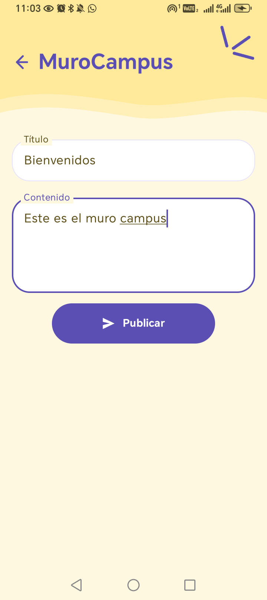
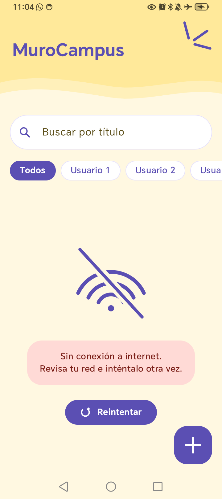
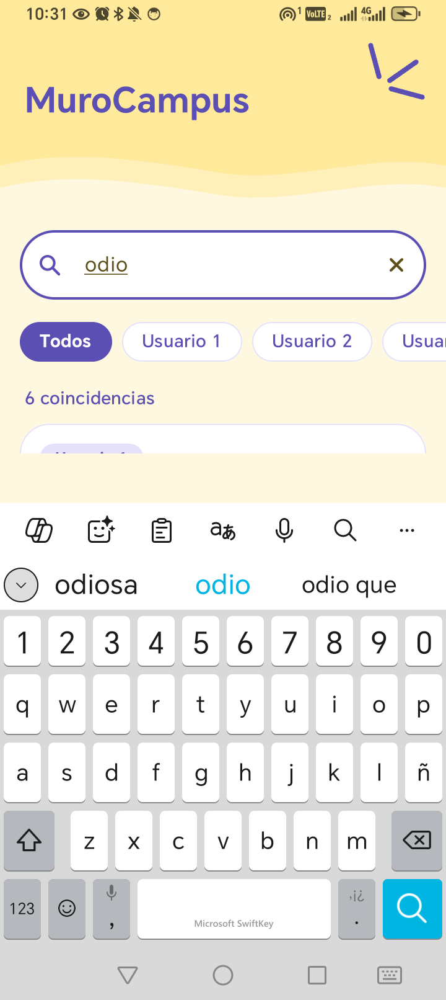
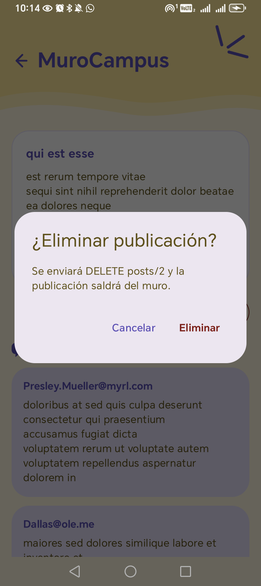
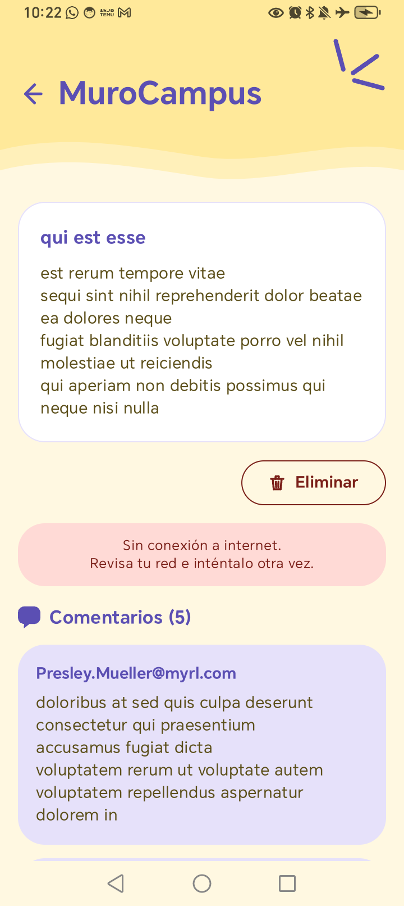

# MuroCampus — Fase 2

**Nombre:** Noemi De la Cruz
**Curso:** Programación en Móviles — Semana 09
**Rama de trabajo:** `con-ia` (Fase 2, con IA) 
**Paquete:** `com.delacruz.murocampus`

## Descripción

MuroCampus es una aplicación Android hecha con Jetpack Compose que consume la API REST de
[JSONPlaceholder](https://jsonplaceholder.typicode.com/). Muestra un muro de publicaciones, permite
abrir el detalle con sus comentarios, filtrar por usuario, crear una publicación nueva y, a partir de
la Fase 2, **borrar** una publicación y **buscar** por título. Todas las peticiones llevan el
encabezado `Accept: application/json` gracias a un interceptor de OkHttp.

Funcionalidades:

- Lista de las 100 publicaciones (`GET posts`) con etiqueta de usuario, título y resumen a dos líneas.
- Detalle de una publicación con sus 5 comentarios (`GET posts/{id}` y `GET posts/{id}/comments`).
- Filtro por usuario con chips: Todos y Usuario 1 a Usuario 10 (`GET posts?userId=N`).
- Crear publicación (`POST posts` con `@Body`) y mensaje con el id devuelto por el servidor.
- **Eliminar publicación** desde el detalle (`DELETE posts/{id}`), con diálogo de confirmación.
- **Buscador** que filtra por título las publicaciones ya descargadas, sin volver a llamar a la API.
- **Encabezado `Accept: application/json`** en todas las peticiones mediante un interceptor de OkHttp.
- Estados claros de **Cargando**, **Éxito** y **Error** con botón **Reintentar**, también en el borrado.

## Mejoras de la Fase 2

| # | Mejora | Qué hace | Capas que cambian | Commit |
|---|---|---|---|---|
| 1 | Borrar publicación | `@DELETE("posts/{id}")` con `Response<Unit>` y revisión del código HTTP | API + Repository + ViewModel + View | `5ec8d61` |
| 2 | Búsqueda | Campo que filtra por título lo ya descargado | ViewModel + View | `affb931` |
| 3 | Encabezado con interceptor | `Accept: application/json` en todas las peticiones | RetrofitClient | `9b80293` |

Además, aparte de las mejoras, la rama incluye el rediseño visual (`420874b`): cabecera de olas,
paleta morada y amarilla, tarjetas de 24 dp e íconos dibujados con `Canvas`. No cuenta como una de las
mejoras de la tabla, pero cambia la presentación de todas las pantallas.

### 1. Borrar publicación

- `PostApi.kt`: `@DELETE("posts/{id}") suspend fun eliminar(@Path("id") id: Int): Response<Unit>`.
  Devuelve la respuesta completa para poder revisar el código.
- `PostRepository.kt`: `eliminar(id): Result<Unit>` en la interface. `PostRepositoryRemote` comprueba
  `respuesta.isSuccessful` y, si el servidor contesta algo distinto de 2xx, lanza `HttpException` para
  que el fallo llegue al ViewModel como `Result.failure`.
- `PostsViewModel.kt`: `eliminacion: StateFlow<UiState<Unit>?>` y `eliminar(id)`. Al confirmar el
  servidor, quita la publicación de `_lista` con `filterNot` y deja el estado en `Exito`.
- `PantallaDetalle.kt`: botón **Eliminar** con borde rojo, `AlertDialog` de confirmación que indica el
  `DELETE` de esa publicación, indicador de progreso mientras borra y recuadro rosa con el mensaje de
  error. La pantalla solo envía `onEliminar(id)`.
- `MuroCampusApp.kt`: con `LaunchedEffect` vuelve al muro cuando la eliminación termina en `Exito` y
  limpia el estado al abrir o cerrar el detalle.
- **Limitación:** JSONPlaceholder responde 200 pero no guarda el borrado, por eso la publicación sale
  solo de la lista en memoria hasta que se recarga el muro.

### 2. Búsqueda

- `PostsViewModel.kt`: `busqueda: StateFlow<String>` con `buscar(texto)` y una lista derivada
  `listaVisible = combine(_lista, _busqueda) { estado, texto -> estado.conBusqueda(texto) }.stateIn(...)`.
- El filtro es una extensión privada sobre `UiState<List<Post>>`: si el estado es `Exito` y el texto no
  está vacío, se queda con las publicaciones cuyo `title` contiene el texto con `ignoreCase = true`.
  Se aplica sobre lo ya descargado, sin una llamada nueva a la API y combinándose con el chip de usuario.
- `PantallaLista.kt`: campo de búsqueda tipo píldora debajo de la cabecera, con lupa, aspa para vaciar y
  acción *Search* en el teclado. Mientras hay texto muestra **N coincidencias** y, si no hay ninguna,
  el aviso *Sin resultados para “texto”*. `imePadding` evita que el teclado tape los resultados.
- El texto vive en el ViewModel, así que se conserva al abrir un detalle y volver.

### 3. Encabezado con interceptor

- `data/remote/EncabezadoInterceptor.kt`: implementa `okhttp3.Interceptor` y copia la petición con
  `header("Accept", "application/json")`, que reemplaza el encabezado si ya existía en vez de duplicarlo.
- `RetrofitClient.kt`: se registra **antes** del `HttpLoggingInterceptor`, así el encabezado aparece en el
  registro de OkHttp de Logcat y viaja en todas las llamadas de `PostApi`.
- No cambia ninguna firma: `PostApi`, `PostRepository`, ViewModel y pantallas quedan igual. Es la mejora
  de la tabla que toca una sola capa.

## Tecnologías

| Elemento | Uso |
|---|---|
| Kotlin + Jetpack Compose (Material 3) | Interfaz de usuario |
| MVVM + Repository | Arquitectura y separación de capas |
| Retrofit 2.11.0 | `@GET`, `@POST`, `@DELETE`, `@Path`, `@Query` y `@Body` |
| OkHttp 4.12.0 | Conexión, registro en Logcat e **interceptor** del encabezado `Accept` |
| kotlinx.serialization | Conversión del JSON a `data class` |
| Corrutinas, `StateFlow`, `combine` y `Result` | Trabajo asíncrono, estados y búsqueda |

Sin dependencias nuevas: los íconos y la cabecera se dibujan con `Canvas` y el interceptor usa el
OkHttp que ya estaba en el proyecto.

## Estructura de paquetes

```
com.delacruz.murocampus/
├── MainActivity.kt                  Repository + ViewModel + setContent
├── model/
│   └── Modelos.kt                   Post, Comentario, NuevoPost y Usuario
├── data/
│   ├── PostRepository.kt            Interface + PostRepositoryRemote (Result; revisa el DELETE)
│   └── remote/
│       ├── PostApi.kt               Interface de Retrofit (@GET, @POST, @DELETE)
│       ├── EncabezadoInterceptor.kt Accept: application/json en todas las peticiones
│       └── RetrofitClient.kt        Retrofit + OkHttp + interceptor + conversor JSON
├── viewmodel/
│   ├── PostsViewModel.kt            Lista, búsqueda, detalle, creación y eliminación
│   ├── PostsViewModelFactory.kt     Crea el ViewModel con el Repository
│   └── UiState.kt                   Cargando / Éxito / Error y mensajeDe()
└── ui/
    ├── MuroCampusApp.kt             Scaffold, navegación, botón + y BackHandler
    ├── Componentes.kt               CabeceraMuro, tarjetas, estados e íconos Canvas
    ├── PantallaLista.kt             Buscador, chips y LazyColumn
    ├── PantallaDetalle.kt           Publicación, Eliminar y comentarios
    ├── PantallaCrear.kt             Formulario de creación
    └── theme/                       Color.kt, Shape.kt, Type.kt y Theme.kt
```

## Arquitectura MVVM + Repository

```
View (PantallaLista, PantallaDetalle, PantallaCrear)
  |  eventos: cargar, filtrar, buscar, abrir, crear, eliminar
  v
ViewModel (PostsViewModel)  --->  StateFlow<UiState> (Cargando / Éxito / Error)
  |                             listaVisible = combine(lista, busqueda)
  |  viewModelScope.launch
  v
PostRepository (interface)  <--- devuelve Result<...>
  |
  v
PostRepositoryRemote  (revisa el código del DELETE y captura IOException, HttpException, SerializationException)
  |
  v
PostApi (Retrofit) --- OkHttp + EncabezadoInterceptor ---> https://jsonplaceholder.typicode.com/
```

Reglas respetadas:

- La pantalla nunca llama a Retrofit: solo recibe el estado y envía eventos al ViewModel.
- El ViewModel no conoce Retrofit, `PostApi`, `HttpException` ni `Context`.
- El Repository nunca deja escapar una excepción: devuelve `Result.success` o `Result.failure`.
- El filtrado de la búsqueda y la lista que se muestra se calculan en el ViewModel, no en el Composable.
- La cancelación de la corrutina se relanza con `catch (e: CancellationException) { throw e }`.

# Capturas

| Lista con buscador | Detalle con Eliminar | Filtro por usuario |
|---|---|---|
|  |  |  |

| Crear publicación | Sin conexión | Búsqueda |
|---|---|---|
|  |  |  |

| Confirmación de borrado | Error al eliminar | |
|---|---|---|
|  |  | |

## Pruebas realizadas

Fase 2:

| Prueba | Resultado |
|---|---|
| Buscar `odio` con Todos | 6 coincidencias (5, 16, 54, 68, 77 y 83) |
| Buscar `odio` con Usuario 1 | 1 coincidencia |
| Buscar `zzz` | Aviso *Sin resultados para “zzz”* |
| Tocar la X del buscador | Vuelve a las 100 publicaciones y desaparece el contador |
| Abrir un resultado y volver | El texto y los resultados se conservan |
| Eliminar y confirmar | Vuelve al muro y la publicación desaparece de la lista |
| Eliminar en modo avión | Se queda en el detalle con *Sin conexión a internet* |
| Reintentar el borrado con red | Borra y vuelve al muro |
| Interceptor activo | Carga lista, detalle, comentarios y creación sin errores |

Fase 1 (siguen funcionando):

| Prueba | Resultado |
|---|---|
| Abrir la app con internet | Muestra Cargando y luego las 100 publicaciones |
| Modo avión al abrir | Recuadro de error y botón Reintentar |
| Desactivar modo avión y pulsar Reintentar | Vuelve a cargar la lista |
| Abrir una publicación | Detalle completo con 5 comentarios |
| Botón Atrás desde el detalle | Vuelve a la lista sin recargarla |
| Rotar la pantalla | Conserva el estado, no descarga de cero |
| Campos vacíos en Crear | El botón Publicar está deshabilitado |
| Publicar | Mensaje Publicado con id 101 y formulario limpio |

## Para pensar (Fase 2)

**1. ¿Por qué la revisión del código HTTP del `DELETE` va en el Repository y no en el ViewModel?**

Porque el ViewModel solo debe decidir estados, no conocer el protocolo. `PostRepositoryRemote` recibe
`Response<Unit>` de Retrofit, revisa `isSuccessful` y convierte un 4xx o 5xx en `Result.failure`, igual
que hace con cualquier `IOException`. Así el ViewModel sigue viendo solo `Result<Unit>` y no aparece
`HttpException` fuera de la capa de datos.

**2. ¿Por qué el texto del buscador y el filtrado viven en el ViewModel?**

Porque filtrar es lógica, no dibujo. Con `combine` + `stateIn` la pantalla recibe la lista ya filtrada y
solo la dibuja; el texto sobrevive a la rotación y a entrar al detalle y volver, y el filtro se combina
solo con el chip de usuario. Si el filtrado estuviera en el Composable con `remember`, se perdería al
salir de la pantalla y habría lógica de negocio en la vista.

**3. ¿Por qué un interceptor en lugar de escribir el encabezado en cada método de `PostApi`?**

Porque el encabezado debe ser igual en todas las peticiones y un interceptor lo agrega en un solo lugar,
sin repetirlo en cinco métodos ni olvidarlo cuando se agregue uno nuevo. Además se registra en el
`RetrofitClient`, que es la única capa que la tabla de la Fase 2 pide cambiar.

## Para pensar (Fase 1)

**1. ¿Qué diferencia hay entre GET y POST? ¿Por qué crear lleva `@Body` y porUsuario lleva `@Query`?**

`GET` sirve para leer un recurso y no envía cuerpo: todo lo que necesita va en la URL. `POST` sirve
para crear un recurso y envía los datos en el cuerpo de la petición. `crear` lleva `@Body` porque el
servidor necesita el JSON completo de la publicación nueva (`userId`, `title`, `body`) dentro del
cuerpo. `porUsuario` lleva `@Query` porque el usuario es un filtro que viaja como parámetro de la URL
(`posts?userId=2`) y no modifica ningún recurso.

**2. ¿Por qué la ruta es `"posts"` y no `"/posts"`?**

Porque Retrofit concatena la `baseUrl` con la ruta. La `baseUrl` termina en `/`
(`https://jsonplaceholder.typicode.com/`); si la ruta empezara con `/`, Retrofit reemplazaría todo el
camino de la URL base y la petición quedaría mal formada. Con `"posts"` el resultado es
`https://jsonplaceholder.typicode.com/posts`.

**3. ¿Por qué el Repository devuelve `Result` en vez de dejar que la excepción llegue al ViewModel?**

Porque así ninguna excepción de red atraviesa las capas. El Repository captura `IOException`,
`HttpException`, `SerializationException`, etc. y las convierte en `Result.failure`. El ViewModel
decide el `UiState` sin conocer Retrofit y la app no se cierra.

**4. ¿Qué pasa si olvidas el permiso INTERNET? ¿Y si olvidas `ignoreUnknownKeys`?**

Sin el permiso `INTERNET` la app compila, pero OkHttp no puede abrir conexiones: la llamada falla y se
ve el mensaje de error de red aunque el teléfono tenga internet. Sin `ignoreUnknownKeys`, cuando el
servidor agrega un campo que no existe en la `data class`, kotlinx.serialization lanza
`SerializationException` y la pantalla muestra "Respuesta inesperada".

**5. ¿Por qué la pantalla de lista usa un `when` sobre `UiState` y no un `if` con tres variables?**

Porque `UiState` es una interface sellada: el compilador obliga a cubrir los tres casos y no permite
estados imposibles, como estar cargando y con error al mismo tiempo. Además el estado vive en el
ViewModel, así que sobrevive a la rotación de la pantalla.

**6. JSONPlaceholder no guarda los POST. ¿Cómo cambiaría tu app si usaras un servicio real?**

Con un servicio real el `POST` sí persistiría: el id devuelto sería definitivo y la publicación
aparecería al recargar la lista. Lo mismo pasaría con el `DELETE`: no haría falta quitarlo de la lista
en memoria. Convendría manejar autenticación con token, validar errores del servidor (400, 401, 409) y
refrescar con paginación. El resto de la arquitectura no cambiaría: solo se adaptaría el Repository.

## Documentación de la IA

Los prompts de la Fase 2, qué respondió la IA, qué se cambió y por qué están en
[`PROMPTS.md`](PROMPTS.md).

## Cómo ejecutar

1. Abrir la carpeta `Semana09/MuroCampus` en Android Studio.
2. Sincronizar Gradle (`Sync Now`).
3. Ejecutar en el emulador o en el teléfono.
4. Comprobar la API en el navegador: <https://jsonplaceholder.typicode.com/posts/1>.
