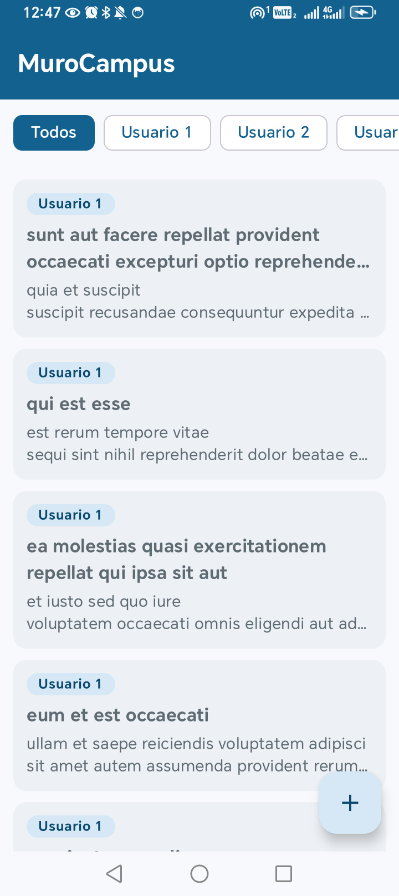
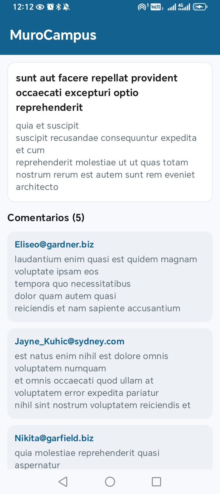
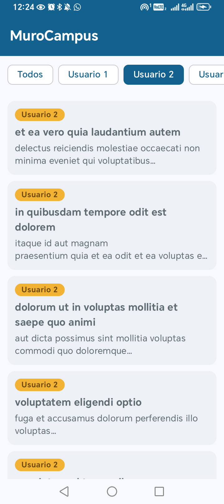

# MuroCampus

**Nombre:** Noemi De la Cruz
**Curso:** Programación en Móviles — Semana 09
**Rama de trabajo:** `sin-ia` (Fase 1, sin IA)
**Paquete:** `com.delacruz.murocampus`

## Descripción

MuroCampus es una aplicación Android hecha con Jetpack Compose que consume la API REST de
[JSONPlaceholder](https://jsonplaceholder.typicode.com/). Muestra un muro de publicaciones,
permite abrir el detalle con sus comentarios, filtrar por usuario y crear una publicación nueva.
También muestra estados claros de **Cargando**, **Éxito** y **Error** cuando no hay internet.

Funcionalidades:

- Lista de las 100 publicaciones (`GET posts`), con etiqueta de usuario, título y resumen a dos líneas.
- Detalle de una publicación con sus 5 comentarios (`GET posts/{id}` y `GET posts/{id}/comments`).
- Filtro por usuario con chips: Todos y Usuario 1 a Usuario 10 (`GET posts?userId=N`).
- Crear publicación (`POST posts` con `@Body`) y mensaje con el id devuelto por el servidor.
- Manejo de errores de red con mensaje y botón **Reintentar**.

## Tecnologías

| Elemento | Uso |
|---|---|
| Kotlin + Jetpack Compose (Material 3) | Interfaz de usuario |
| MVVM + Repository | Arquitectura y separación de capas |
| Retrofit 2.11.0 | Llamadas HTTP con anotaciones `@GET`, `@POST`, `@Path`, `@Query` y `@Body` |
| OkHttp 4.12.0 + Logging Interceptor | Conexión y registro del tráfico en Logcat |
| kotlinx.serialization | Conversión del JSON a `data class` |
| Corrutinas, `StateFlow` y `Result` | Trabajo asíncrono y manejo de errores |

## Estructura de paquetes

```
com.delacruz.murocampus/
├── MainActivity.kt              Contenedor: barra MuroCampus y navegación lista/detalle/crear
├── model/
│   └── Modelos.kt               Post, Comentario, NuevoPost y Usuario
├── data/
│   ├── PostRepository.kt        Interface + PostRepositoryRemote (devuelve Result)
│   └── remote/
│       ├── PostApi.kt           Interface de Retrofit
│       └── RetrofitClient.kt    Retrofit + OkHttp + conversor JSON
├── viewmodel/
│   ├── PostsViewModel.kt        Estado de lista, detalle, filtro y creación
│   ├── PostsViewModelFactory.kt Crea el ViewModel con el Repository
│   └── UiState.kt               Cargando / Éxito / Error y mensajeDe()
└── ui/
    ├── Componentes.kt           TarjetaPost, Cargando y ErrorConReintento
    ├── PantallaLista.kt         Chips de filtro y LazyColumn de publicaciones
    ├── PantallaDetalle.kt       Publicación completa y comentarios
    ├── PantallaCrear.kt         Formulario de creación
    └── theme/                   Colores, tema y tipografía
```

## Arquitectura MVVM + Repository

```
View (PantallaLista, PantallaDetalle, PantallaCrear)
  |  eventos: cargar, filtrar, abrir, publicar
  v
ViewModel (PostsViewModel)  --->  StateFlow<UiState> (Cargando / Éxito / Error)
  |  viewModelScope.launch
  v
PostRepository (interface)  <--- devuelve Result<...>
  |
  v
PostRepositoryRemote  (captura IOException, HttpException, SerializationException)
  |
  v
PostApi (Retrofit) --- OkHttp ---> https://jsonplaceholder.typicode.com/
```

Reglas respetadas:

- La pantalla nunca llama a Retrofit: solo recibe el estado y envía eventos al ViewModel.
- El ViewModel no conoce Retrofit, `PostApi`, `HttpException` ni `Context`.
- El Repository nunca deja escapar una excepción: devuelve `Result.success` o `Result.failure`.
- La cancelación de la corrutina se relanza con `catch (e: CancellationException) { throw e }`.

## Capturas

| Lista | Detalle |
|---|---|
|  |  |

| Filtro por usuario | Crear publicación |
|---|---|
|  |  |

| Sin conexión |
|---|
|  |

## Pruebas realizadas en el dispositivo

| Prueba | Resultado |
|---|---|
| Abrir la app con internet | Muestra Cargando y luego las 100 publicaciones |
| Modo avión al abrir | Recuadro de error y botón Reintentar |
| Desactivar modo avión y pulsar Reintentar | Vuelve a cargar la lista |
| Abrir una publicación | Detalle completo con 5 comentarios |
| Botón Atrás desde el detalle | Vuelve a la lista sin recargarla |
| Modo avión en el detalle | Error con Reintentar; al reintentar carga el detalle |
| Elegir Usuario 2 | Solo publicaciones del usuario 2 |
| Elegir Todos | Vuelven las 100 publicaciones |
| Pedir una publicación inexistente | Error del servidor (404) con Reintentar |
| Rotar la pantalla | Conserva el estado, no descarga de cero |
| Campos vacíos en Crear | El botón Publicar está deshabilitado |
| Publicar | Mensaje Publicado con id 101 y formulario limpio |

## Para pensar

**1. ¿Qué diferencia hay entre GET y POST? ¿Por qué crear lleva `@Body` y porUsuario lleva `@Query`?**

`GET` sirve para leer un recurso y no envía cuerpo: todo lo que necesita va en la URL. `POST` sirve
para crear un recurso y envía los datos en el cuerpo de la petición. `crear` lleva `@Body` porque el
servidor necesita el JSON completo de la publicación nueva (`userId`, `title`, `body`) dentro del
cuerpo. `porUsuario` lleva `@Query` porque el usuario es un filtro que viaja como parámetro de la URL
(`posts?userId=2`) y no modifica ningún recurso.

**2. ¿Por qué la ruta es `"posts"` y no `"/posts"`?**

Porque Retrofit concatena la `baseUrl` con la ruta. La `baseUrl` termina en `/`
(`https://jsonplaceholder.typicode.com/`); si la ruta empezara con `/`, Retrofit reemplazaría todo el
camino de la URL base y la petición quedaría mal formada. Con `"posts"` el resultado es
`https://jsonplaceholder.typicode.com/posts`.

**3. ¿Por qué el Repository devuelve `Result` en vez de dejar que la excepción llegue al ViewModel?**

Porque así ninguna excepción de red atraviesa las capas. El Repository captura `IOException`,
`HttpException`, `SerializationException`, etc. y las convierte en `Result.failure`. El ViewModel
decide el `UiState` sin conocer Retrofit y la app no se cierra. Además permite cambiar la fuente de
datos (por ejemplo una base de datos local) sin tocar el ViewModel ni la pantalla.

**4. ¿Qué pasa si olvidas el permiso INTERNET? ¿Y si olvidas `ignoreUnknownKeys` y el servidor agrega un campo nuevo?**

Sin el permiso `INTERNET` la app compila, pero OkHttp no puede abrir conexiones: la llamada falla y se
ve el mensaje de error de red aunque el teléfono tenga internet. Sin `ignoreUnknownKeys`, cuando el
servidor agrega un campo que no existe en la `data class`, kotlinx.serialization lanza
`SerializationException` y la pantalla muestra "Respuesta inesperada". Con `ignoreUnknownKeys = true`
los campos desconocidos se ignoran y la app sigue funcionando.

**5. ¿Por qué la pantalla de lista usa un `when` sobre `UiState` y no un `if` con tres variables?**

Porque `UiState` es una interface sellada: el compilador obliga a cubrir los tres casos y no permite
estados imposibles, como estar cargando y con error al mismo tiempo. Con tres booleanos sí se pueden
dar combinaciones inválidas y hay que revisarlas a mano. Además el estado vive en el ViewModel, así
que sobrevive a la rotación de la pantalla.

**6. JSONPlaceholder no guarda los POST. ¿Cómo cambiaría tu app si usaras un servicio real?**

Con un servicio real el `POST` sí persistiría: el id devuelto sería definitivo y la publicación
aparecería al recargar la lista. Convendría insertar la respuesta en la lista sin volver a descargar
todo, manejar autenticación con token, validar errores del servidor (400, 401, 409) y quizá refrescar
con paginación. El resto de la arquitectura no cambiaría: solo se adaptaría el Repository.

## Cómo ejecutar

1. Abrir la carpeta `Semana09/MuroCampus` en Android Studio.
2. Sincronizar Gradle (`Sync Now`).
3. Ejecutar en un emulador.
4. Comprobar la API en el navegador: <https://jsonplaceholder.typicode.com/posts/1>.
