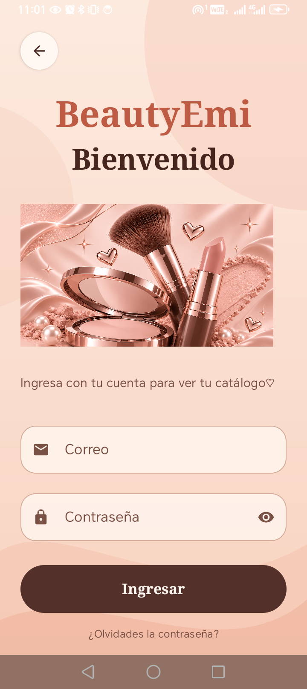
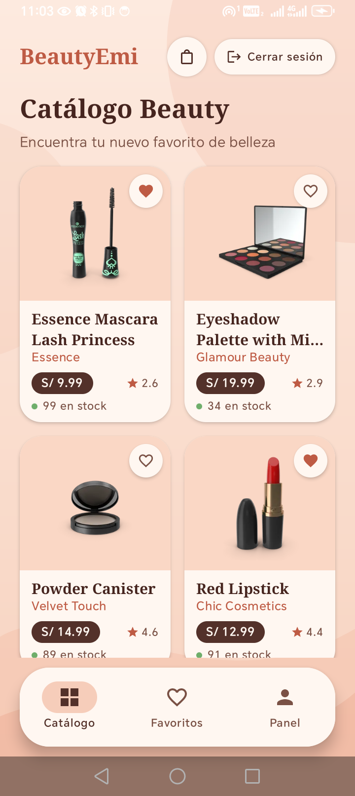
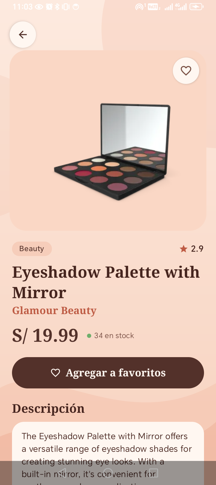
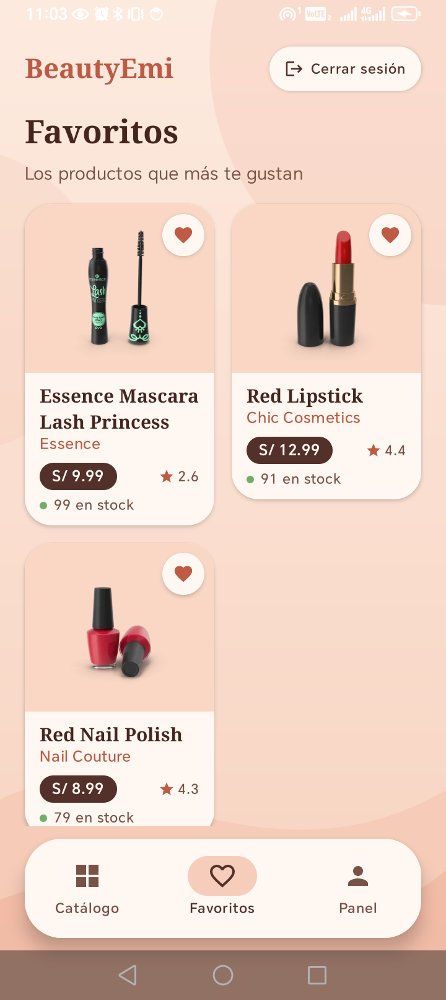
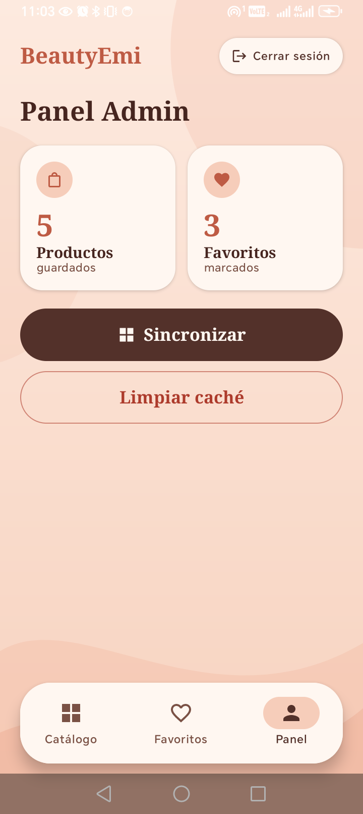
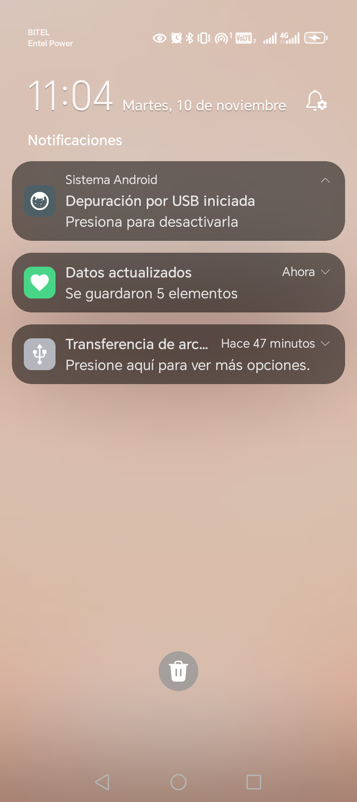
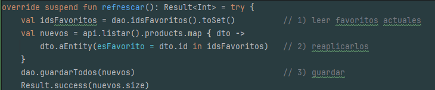

# BeautyEmi — Catálogo de belleza

Aplicación Android del laboratorio integrador de Programación Móviles.
Permite iniciar sesión con Firebase, ver un catálogo de productos de belleza,
consultar el detalle, marcar favoritos y, si la persona tiene rol **admin**,
usar un panel para sincronizar y limpiar la caché local.

| Dato | Valor |
|---|---|
| Tema | Productos |
| Variante | Categoría `beauty` |
| API | DummyJSON (pública, sin clave) |
| Paquete | `com.delacruz.catalogo` |
| Sistema mínimo | Android 7.0 (API 24) |
| Repositorio | `Programacion_Moviles_delacruz` |

## 1. Tema y variante

El tema asignado es **Productos**. La variante trabajada es la categoría
**`beauty`** de DummyJSON, con estos dos endpoints:

| Uso | Endpoint |
|---|---|
| Lista | `GET https://dummyjson.com/products/category/beauty` |
| Detalle | `GET https://dummyjson.com/products/{id}` |

La lista se descarga con Retrofit y se guarda en Room. Room es la fuente única
de verdad: la pantalla siempre lee de la base local, así la app funciona sin
internet y los favoritos sobreviven a cada sincronización.

## 2. Funcionalidades

- **Login** con correo y contraseña (Firebase Authentication), con validación
  de campos vacíos y mensaje si las credenciales fallan.
- **Dos roles** (`admin` y `usuario`) leídos desde Firestore. El rol decide qué
  pestañas ve la persona.
- **Catálogo** con estados Cargando, Error (con botón Reintentar) y Vacío.
- **Detalle** de cada producto con precio, marca, stock, calificación y
  descripción.
- **Favoritos** persistentes, con pantalla propia y botón para marcar o
  desmarcar.
- **Modo sin conexión**: sin internet se muestra lo guardado y un aviso; si no
  hay nada guardado aparece el error con Reintentar.
- **Notificación local** al terminar de sincronizar: «Se guardaron N
  elementos». Usa canal propio y el permiso `POST_NOTIFICATIONS`.
- **Panel Admin**: total de productos guardados, total de favoritos, botón
  Sincronizar y botón Limpiar caché.
- **Sesión persistente**: se mantiene al reabrir la app y se cierra desde la
  barra superior («Cerrar sesión»), presente en Catálogo, Favoritos y Panel.

## 3. Arquitectura y estructura

El proyecto sigue **MVVM** con `UiState` (`Cargando`, `Exito`, `Error`),
ViewModel por pantalla y un repositorio como interfaz. Los ViewModel no
conocen Android: reciben el repositorio y, cuando corresponde, un
`Notificador` por constructor mediante `ViewModelProvider.Factory`.

```
app/src/main/java/com/delacruz/catalogo/
├── MainActivity.kt              arranque, sesión y permiso de notificaciones
├── AppContainer.kt              composición de dependencias
├── data/
│   ├── local/                   Room: Entity, Dao, Database
│   ├── remote/                  Retrofit: ApiService y DTO
│   ├── mapper/                  DTO ↔ Entity ↔ modelo de dominio
│   └── repository/              ItemRepository + implementación
├── domain/model/                modelo Item
├── notification/                Notificador y NotificadorAndroid
└── ui/
    ├── lista/ detalle/ favoritos/ admin/ login/ bienvenida/
    ├── components/              BarraSuperior, tarjetas, fondos, estados
    ├── navigation/              NavHost, rutas y barra inferior
    └── theme/                   colores, tipografía y tema
app/src/test/java/com/delacruz/catalogo/ui/lista/
└── ListaViewModelTest.kt        3 pruebas unitarias del ViewModel
```

Dependencias principales: Jetpack Compose + Material 3, Navigation Compose,
Room (KSP), Retrofit + Gson + OkHttp, Coil, Firebase Authentication,
Cloud Firestore y notificaciones locales.

## 4. Cómo compilar y ejecutar

### Requisitos

- Android Studio con JDK 17 o superior.
- SDK de Android con **compileSdk 37.1** (el proyecto usa AGP 9.2.1).
- Un dispositivo físico o emulador con Android 7.0 (API 24) o superior.
- Un proyecto de Firebase propio (ver la sección 5).

### Pasos

1. Clonar el repositorio y abrir la carpeta `Semana12/Catalogo` en Android
   Studio.
2. Colocar tu `google-services.json` dentro de `app/`. Ese archivo **no está
   versionado** porque contiene una clave de API.
3. Sincronizar Gradle (el plugin `com.google.gms.google-services` lee el JSON).
4. Compilar la APK de depuración:

   ```powershell
   .\gradlew.bat :app:assembleDebug
   ```

   En macOS o Linux:

   ```bash
   ./gradlew :app:assembleDebug
   ```

   La APK queda en `app/build/outputs/apk/debug/app-debug.apk`.

5. Instalar y abrir en el dispositivo conectado por USB (con depuración
   activada):

   ```powershell
   .\gradlew.bat :app:installDebug
   adb shell am start -n com.delacruz.catalogo/.MainActivity
   ```

6. Ejecutar las pruebas unitarias:

   ```powershell
   .\gradlew.bat :app:testDebugUnitTest
   ```

> Si aparece `Default FirebaseApp is not initialized`, revisa que
> `google-services.json` esté en `app/`, que el plugin esté aplicado y haz
> Clean + Rebuild.

## 5. Cómo crear los usuarios de prueba

La app **no tiene pantalla de registro**: los usuarios se crean en la consola
de Firebase. El detalle completo (proyecto, reglas y verificación) está en
[`docs/FIREBASE.md`](docs/FIREBASE.md).

1. Crear un proyecto en <https://console.firebase.google.com> y registrar una
   app Android con el `applicationId` del proyecto:
   `com.delacruz.catalogo`.
2. Descargar `google-services.json` y guardarlo en `app/`.
3. En **Authentication → Método de acceso**, habilitar
   **Correo electrónico/contraseña**.
4. En **Authentication → Usuarios**, crear dos cuentas, una para cada rol, con
   el correo y la contraseña que elijas:

   | Uso | Rol en Firestore |
      |---|---|
   | Cuenta de administrador | `admin` |
   | Cuenta de usuario normal | `usuario` |

5. En **Firestore Database**, crear la colección `usuarios`. Por cada cuenta,
   crear un documento **cuyo ID sea el UID** de Authentication (no un ID
   automático) con este contenido:

   ```
   usuarios/{uid}
     rol:    "admin"      // o "usuario"
     nombre: "Nombre de la persona"
   ```

   Si el ID del documento no es el UID, la app siempre tratará a la persona
   como `usuario`.

6. Publicar reglas de seguridad para que cada persona solo lea su documento:

   ```
   rules_version = '2';
   service cloud.firestore {
     match /databases/{database}/documents {
       match /usuarios/{uid} {
         allow read: if request.auth != null && request.auth.uid == uid;
         allow write: if false;
       }
     }
   }
   ```

Las contraseñas **no se guardan en el repositorio**: se definen al crear las
cuentas en la consola.

Con la cuenta `admin` se ven **Catálogo, Favoritos y Panel**; con la cuenta
`usuario`, solo **Catálogo y Favoritos**.

## 6. Capturas

| Login | Lista / catálogo | Detalle |
| :---: | :---: | :---: |
|  |  |  |

| Favoritos | Panel Admin | Notificación |
| :---: | :---: | :---: |
|  |  |  |

## 7. Pruebas

`app/src/test/java/com/delacruz/catalogo/ui/lista/ListaViewModelTest.kt` prueba
el ViewModel de la lista con un `FakeItemRepository` y un `FakeNotificador`,
sin Android, Room, Retrofit ni Firebase:

1. Refresco exitoso → estado `Exito` y notificación «Se guardaron N
   elementos».
2. Fallo sin datos guardados → estado `Error`.
3. Fallo con datos guardados → estado `Exito` y aviso de sin conexión.


## 9. Documentación adicional

- [`docs/FIREBASE.md`](docs/FIREBASE.md): configuración de Firebase paso a paso.
- [`PROMPTS.md`](PROMPTS.md): registro de las consultas realizadas a la IA.

> En el repositorio no se versionan `google-services.json`,
> `local.properties`, `build/` ni `.idea/`.
## 10. Preguntas de sustentación

## 1. ¿Por qué el repository es una interface? ¿Qué cambiaría si no lo fuera?

El Repository es una interface porque permite que el ViewModel trabaje sin depender de una implementación específica. Así, podemos cambiar la forma de obtener los datos o hacer pruebas sin utilizar una base de datos real.

¿Qué cambiaría si no fuera una interface?

El ViewModel dependería directamente de la clase que conecta con la base de datos y la API, haciendo que las pruebas sean más difíciles y que cambiar el origen de los datos sea más complicado.


## 2. ¿Por qué la lista sale de Room y no directamente de Retrofit?

La lista sale de Room porque es la base de datos local del celular. Así, la aplicación puede mostrar los datos incluso cuando no hay internet.

Retrofit solo se encarga de traer o actualizar los datos desde internet.

¿Qué pasaría si saliera directamente de Retrofit?

Necesitaríamos internet para mostrar la lista y no podríamos consultar los datos guardados cuando estemos desconectados.

- Room guarda y muestra los datos; Retrofit los obtiene de internet y actualiza la información.


## 3. ¿Qué pasa con los favoritos cuando sincronizas? Muéstralo en el código.

**El problema:** `@Upsert` reemplaza la fila completa. Los datos de la API no
traen `esFavorito`, así que si se guardan tal cual, todos los favoritos vuelven
a `false`.

**La solución** está en `ItemRepositoryImpl.refrescar()`:




Y la consulta que lo permite, en `ItemDao.kt`:

```kotlin
@Query("SELECT id FROM items WHERE esFavorito = 1")
suspend fun idsFavoritos(): List<Int>
```

**Orden clave:** primero se leen los ids favoritos, luego se descarga y se
marca cada producto como favorito si su id estaba en esa lista, y recién
después se guarda.
---

## 4. ¿Dónde se decide el rol de la persona y por qué no en la pantalla?

**El rol no está escrito en la app.** Se guarda en Firestore, en
`usuarios/{uid}`, campo `rol` (`"admin"` o `"usuario"`), y se lee después de
iniciar sesión. Eso ocurre en `data/auth/FirebaseAuthRepository.kt`:

```kotlin
private suspend fun leerSesion(uid: String, correo: String): Sesion {
    val documento = db.collection("usuarios").document(uid).get().await()
    val rol = if (documento.getString("rol")?.trim() == "admin") Rol.ADMIN else Rol.USUARIO
    return Sesion(uid = uid, correo = correo, rol = rol)
}
```
Luego `AppNav` usa `sesion.rol` para decidir qué mostrar:

```kotlin
val esAdmin = sesion.rol == Rol.ADMIN
```

**Por qué no en la pantalla:** la pantalla solo dibuja. Decidir el rol es lógica
de datos y le corresponde al repositorio de autenticación. Así la pantalla no
conoce Firebase ni sabe de dónde sale el rol.

**Detalle importante de seguridad:** validar el rol en la app solo cambia lo que
se muestra. Lo que protege los datos de verdad son las **reglas de Firestore**
(cada persona solo lee su propio documento y `allow write: if false`).

**Si el rol siempre sale «usuario»:** casi siempre es porque el ID del
documento en Firestore no es el UID de Authentication.

---

## 5. Muestra un commit tuyo y explica qué cambió.

Mi commit fue 310269e. En ese cambio agregué dos controles para manejar errores en las funciones refrescar() y obtenerDetalle().

Uno permite que la cancelación de una tarea continúe correctamente y el otro controla cualquier otro error inesperado.

- Mejoré el manejo de errores para evitar problemas en la aplicación.

## 6. ¿Qué ocurre si el permiso de notificaciones está negado?

Si el permiso de notificaciones está negado, la aplicación sigue funcionando normalmente, pero no muestra notificaciones.

La lista, los favoritos y la sincronización siguen funcionando igual. Además, el sistema comprueba si tiene permiso antes de mostrar una notificación.

- Si el usuario no acepta las notificaciones, la aplicación funciona igual, pero sin enviar avisos.