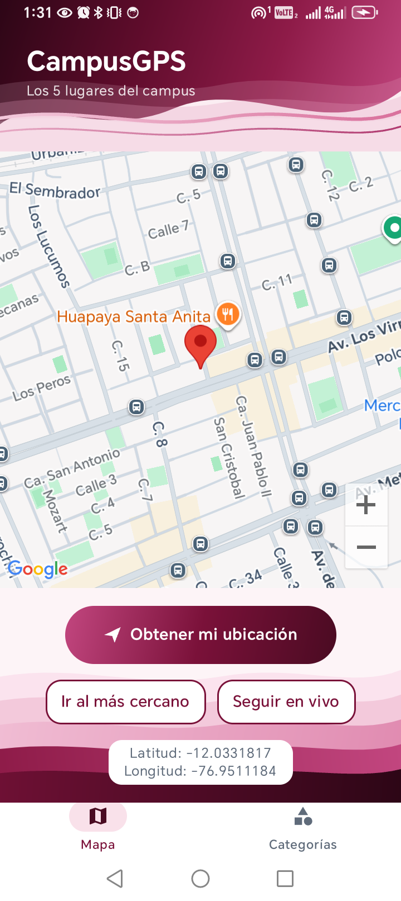
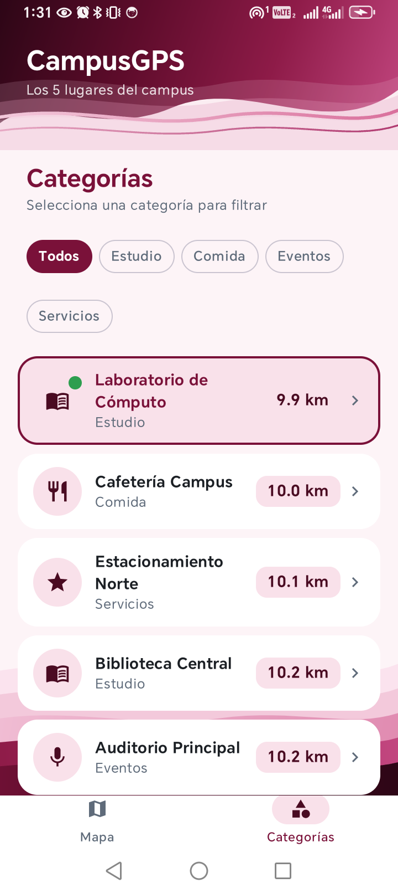
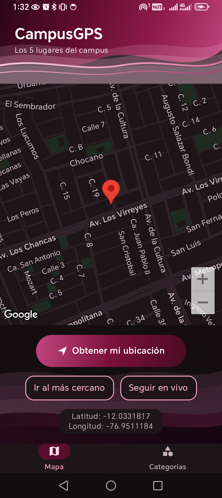
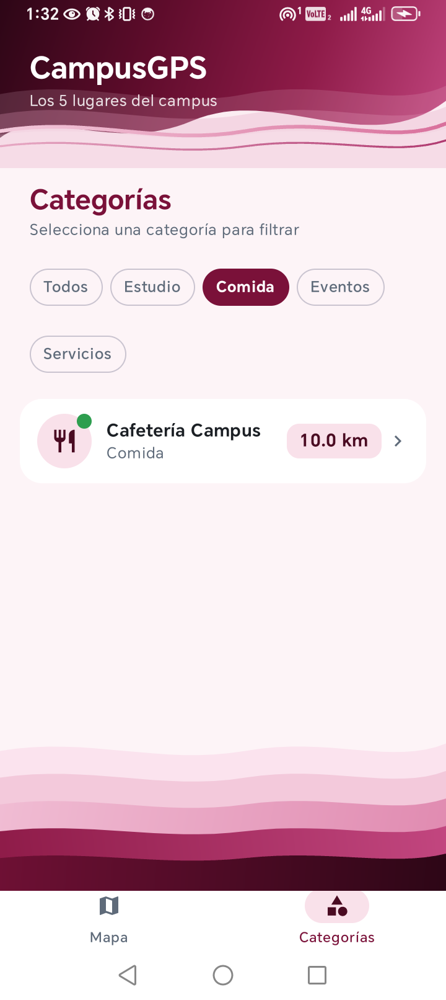
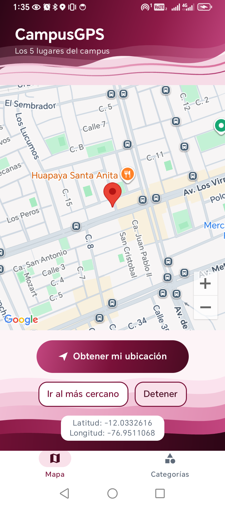

# CampusGPS

**Programación en Dispositivos Móviles — Semana 13** · Noemi De La Cruz

App Android en Kotlin + Jetpack Compose que muestra tu ubicación y cinco lugares
del campus en Google Maps, calcula la distancia real a cada uno y resalta el más
cercano. Sigue MVVM + Repository: cualquier error de permiso o GPS se explica con
un mensaje y una acción, nunca con un cierre inesperado.

## Qué cambia respecto a `sin-ia`

Las tres mejoras de la Fase 2:

- **Modo oscuro**: `darkColorScheme` y mapa nocturno con `MapStyleOptions` y `res/raw/mapa_oscuro.json`.
- **Filtro por categoría**: chips **Todos**, Estudio, Comida, Eventos y Servicios que filtran mapa y lista a la vez con `combine`.
- **Seguimiento en vivo**: `callbackFlow` sobre `requestLocationUpdates`; actualiza cada ~3 s y se detiene con `awaitClose`.

Los extras del rediseño:

- **Íconos por categoría** en cada fila y en la tarjeta del más cercano (`material-icons-extended`).
- **Dos pestañas** Mapa y Categorías, con barra compacta de 48 dp que conserva cámara y filtro al cambiar.
- **Olas compartidas**: un solo `OlasInferiores` de 120 dp, con las mismas cinco capas, al fondo de las dos pestañas.
- **Modo horizontal**: en *landscape* el mapa y los controles se reparten en dos columnas.

## Estructura de paquetes

```text
com.delacruz.campusgps/
├── MainActivity.kt
├── model/      Modelos.kt (Posicion, Lugar, LugarConDistancia, TipoError, UbicacionUi)
├── data/       UbicacionRepository.kt · UbicacionRepositoryGoogle.kt
│               LugaresRepository.kt · LugaresRepositoryLocal.kt
├── util/       Distancia.kt (haversine) · Formato.kt ("110 m" / "1.5 km")
├── viewmodel/  MapaViewModel.kt · CampusViewModelFactory.kt
└── ui/
    ├── PantallaMapa.kt      pestañas, cabecera, estados y navegación
    ├── MapaUbicacion.kt     mapa, marcadores, estilo nocturno y cámara
    ├── componentes/
    │   ├── BotonUbicacion.kt      botón principal con degradado
    │   ├── BotonSecundario.kt     botón de contorno de las acciones
    │   ├── ChipsCategoria.kt      filtros en FlowRow
    │   ├── ListaLugares.kt        filas con ícono, categoría y distancia
    │   ├── MensajeError.kt        error con su acción
    │   ├── Olas.kt                olas superiores e inferiores con Canvas
    │   └── TarjetaMasCercano.kt   tarjeta del lugar más cercano
    └── theme/    Color.kt · Theme.kt · Type.kt
```

## Capturas del diseño actual

Las cinco primeras son las que pide el PDF del laboratorio; las tres últimas,
una por mejora de la Fase 2.

| | |
| :---: | :---: |
|  |  |
| **Figura 1.** Permiso de ubicación. | **Figura 2.** Mapa con tu ubicación. |

| | |
| :---: | :---: |
|  |  |
| **Figura 3.** Marcadores del campus. | **Figura 4.** Lista ordenada por distancia. |

| | |
| :---: | :---: |
|  |  |
| **Figura 5.** Error de permiso, con **Abrir ajustes**. | **Figura 6.** Modo oscuro y mapa nocturno. |

| | |
| :---: | :---: |
|  |  |
| **Figura 7.** Filtro por categoría: Comida. | **Figura 8.** Seguimiento en vivo, con **Detener**. |

## Para pensar

**¿Por qué el GPS está en el Repository y no en el ViewModel?**
Porque el ViewModel no debe conocer Android ni recibir un `Context`; detrás de
`UbicacionRepository` se puede probar con un fake o cambiar de proveedor.

**¿Qué diferencia hay entre el permiso y la clave de Maps?**
El permiso lo da el usuario y protege su privacidad; sin él hay `SIN_PERMISO` y
**Abrir ajustes**, pero el mapa sigue. La clave es una credencial de Google Cloud:
si falta, el mapa sale gris, pero la ubicación y la lista funcionan.

**¿Por qué la clave va en `local.properties`?**
Porque ese archivo está en `.gitignore` y Gradle la inyecta como
`manifestPlaceholders`; así el repositorio nunca guarda la credencial.

**¿Dónde se calcula la distancia y por qué no en el Composable?**
En `util/Distancia.kt` con haversine, y la llama `MapaViewModel`. En el Composable
se repetiría en cada recomposición y la vista tendría lógica de negocio.

**¿Qué pasa si niegan el permiso dos veces?**
Desde Android 11 el sistema ya no muestra el diálogo: la app publica
`Error(..., SIN_PERMISO)` y ofrece **Abrir ajustes** sin cerrarse.

## Cómo ejecutar

1. Abre `Semana13/CampusGPS` en Android Studio y usa un emulador con Google Play.
2. Crea `local.properties` con `sdk.dir` y `MAPS_API_KEY`: está en `.gitignore`, así que la clave nunca se sube.
3. Pon la ubicación en el punto base `-12.0464, -77.0428` y ejecuta `./gradlew :app:assembleDebug`.

Los prompts de la Fase 2 están en [`PROMPTS.md`](PROMPTS.md).
