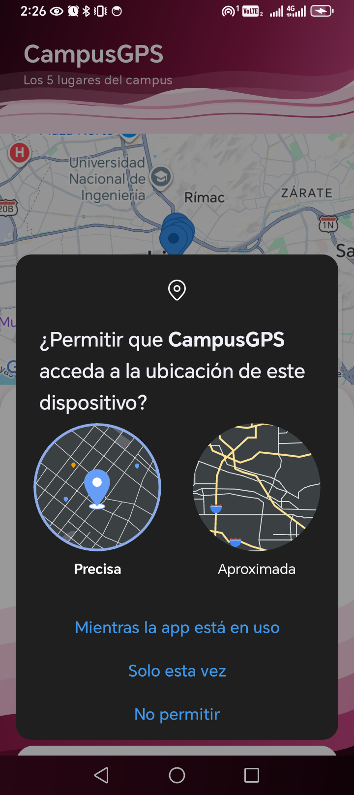
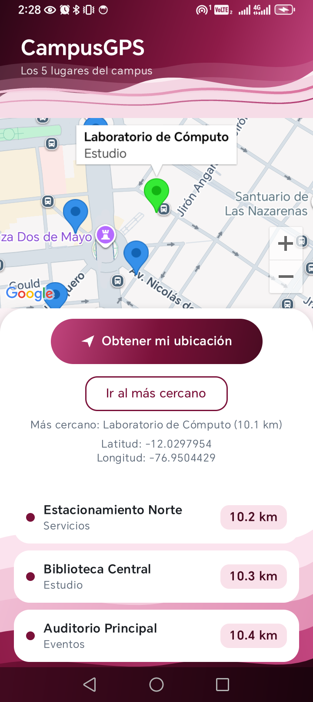
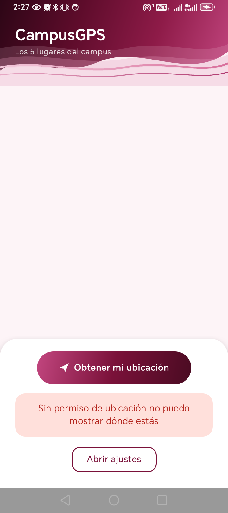
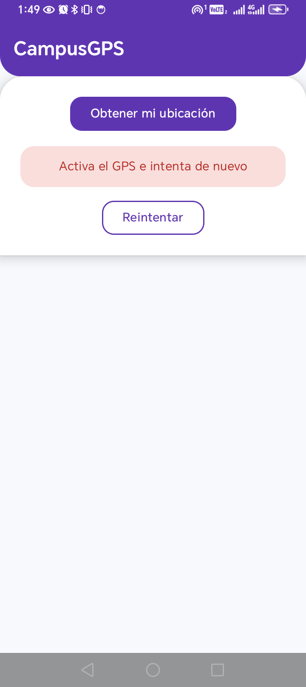

# CampusGPS

**Curso:** Programación en Dispositivos Móviles
**Estudiante:** Noemí De La Cruz
**Laboratorio:** Semana 13 — Google Maps, ubicación y arquitectura MVVM + Repository
**Framework UI:** Jetpack Compose (Material 3)

---

## Índice

1. [Descripción](#descripción)
2. [Funcionalidad](#funcionalidad)
3. [Tecnologías](#tecnologías)
4. [Configuración de la clave de Maps](#configuración-de-la-clave-de-maps)
5. [Estructura de paquetes](#estructura-de-paquetes)
6. [Arquitectura MVVM + Repository](#arquitectura-mvvm--repository)
7. [Capturas](#capturas)
8. [Datos de prueba](#datos-de-prueba)
9. [Cómo ejecutar](#cómo-ejecutar)
10. [Pruebas de aceptación](#pruebas-de-aceptación)
11. [Para pensar](#para-pensar)

---

## Descripción

CampusGPS es una aplicación Android que muestra en Google Maps la ubicación
actual del usuario y los cinco lugares del campus, calcula la distancia real
de cada lugar respecto a esa posición, ordena la lista de menor a mayor y
resalta en verde el lugar más cercano.

La app pide el permiso de ubicación en tiempo de ejecución, mueve la cámara
del mapa cuando el usuario elige un lugar de la lista y explica con un mensaje
y una acción concreta qué hacer cuando falta el permiso, el GPS está apagado o
el dispositivo no tiene Google Play Services. Nunca se cierra por un error.

## Funcionalidad

- **Permiso en tiempo de ejecución** con `rememberLauncherForActivityResult`:
  si el usuario acepta se busca la ubicación, si niega se muestra un mensaje
  con el botón **Abrir ajustes**.
- **Marcador propio** rojo con el título *Estás aquí* y cámara que viaja hasta
  la posición obtenida.
- **Cinco marcadores** de los lugares del campus en azul, con nombre y
  categoría en la ventana de información; el más cercano se dibuja en verde.
- **Lista ordenada** de menor a mayor distancia, con la distancia en un chip y
  el punto del lugar más cercano en verde.
- **Selección**: al tocar una tarjeta la cámara viaja al lugar, la tarjeta queda
  resaltada y el mapa abre su ventana de información.
- **Botón "Ir al más cercano"**, deshabilitado mientras no se haya buscado la
  ubicación.
- **Estados de error**: permiso denegado, GPS apagado y sin Google Play
  Services, cada uno con el botón que corresponde.

## Tecnologías

| Elemento | Versión / uso |
| --- | --- |
| Kotlin + Jetpack Compose | UI declarativa, Material Design 3 |
| `com.google.maps.android:maps-compose` | 8.3.1 — `GoogleMap`, `Marker` |
| `com.google.android.gms:play-services-location` | 21.3.0 — `FusedLocationProviderClient` |
| `org.jetbrains.kotlinx:kotlinx-coroutines-play-services` | `await()` sobre las `Task` de Google |
| `androidx.lifecycle:lifecycle-viewmodel-compose` | `viewModel()`, `StateFlow` + `collectAsState()` |
| Patrón | MVVM + Repository con interfaces |

## Configuración de la clave de Maps

La clave **no vive en el código**. Se guarda en `local.properties`, un archivo
que está en `.gitignore` y que solo existe en la máquina de quien compila:

```properties
sdk.dir=C\:\\ruta\\al\\Android\\Sdk
MAPS_API_KEY=tu_clave_de_maps
```

`app/build.gradle.kts` la convierte en un *placeholder* del manifiesto:

```kotlin
defaultConfig {
    manifestPlaceholders["MAPS_API_KEY"] =
        localProperties.getProperty("MAPS_API_KEY") ?: ""
}
```

y el manifiesto la consume sin mostrar su valor:

```xml
<meta-data
    android:name="com.google.android.geo.API_KEY"
    android:value="${MAPS_API_KEY}" />
```

En Google Cloud la clave debe tener habilitado **Maps SDK for Android** y estar
restringida por nombre de paquete (`com.delacruz.campusgps`) y huella SHA-1 de
la firma con la que se instala la app.

## Estructura de paquetes

```text
com.delacruz.campusgps/
├── MainActivity.kt                      [E]
├── model/
│   └── Modelos.kt                       [E]  Posicion, Lugar, LugarConDistancia, TipoError, UbicacionUi
├── data/
│   ├── UbicacionRepository.kt           [E]  interface
│   ├── UbicacionRepositoryGoogle.kt     [E]  implementación con FusedLocationProviderClient
│   ├── LugaresRepository.kt             [E]  interface
│   └── LugaresRepositoryLocal.kt        [E]  los 5 lugares del campus
├── util/
│   ├── Distancia.kt                     [A]  distancia en metros (haversine)
│   └── Formato.kt                       [A]  "110 m" / "1.5 km"
├── viewmodel/
│   ├── MapaViewModel.kt                 [G]
│   └── CampusViewModelFactory.kt        [E]
└── ui/
    ├── PantallaMapa.kt                  [G]
    ├── MapaUbicacion.kt                 [G]
    ├── ListaLugares.kt                  [A]
    ├── MensajeError.kt                  [A]
    └── theme/                           [E]  Color.kt, Theme.kt, Type.kt
```

Los niveles de la guía son `[E]` = estructura dada, `[G]` = guiado en clase y
`[A]` = autónomo.

## Arquitectura MVVM + Repository

```text
View (PantallaMapa)
   |  evento: pulsar el botón          ^  collectAsState()
   v                                   |
ViewModel (MapaViewModel)  --- StateFlow --->
   |  llama solo a las interfaces
   v
UbicacionRepository  ---> UbicacionRepositoryGoogle (FusedLocationProviderClient)
LugaresRepository    ---> LugaresRepositoryLocal    (los 5 lugares fijos)
```

| Capa | Conoce a | NO debe |
| --- | --- | --- |
| View (`ui/`) | Solo a su ViewModel | Usar Repository, `FusedLocationProviderClient` ni calcular distancias |
| ViewModel | Solo a las interfaces de Repository | Conocer Composables ni recibir un `Context` |
| Repository | Google Play Services (en la implementación) | Exponer clases de UI |
| `util/` | Funciones puras (distancia, formato) | Guardar estado |

**Regla de oro:** la pantalla dibuja según el estado. Ninguna distancia se
calcula dentro de un Composable: `Distancia.kt` la calcula y `MapaViewModel`
arma la lista de `LugarConDistancia` ordenada.

### Flujo de estados

```text
Inicial ──(pulsar)──> Buscando ──(éxito)──> Lista(posicion)
                          │
                          └──(fallo)──> Error(mensaje, tipo)
                                          ├── SIN_PERMISO      -> Abrir ajustes
                                          ├── GPS_APAGADO      -> Reintentar
                                          ├── SIN_PLAY_SERVICES-> solo mensaje
                                          └── OTRO             -> Reintentar
```

`MapaViewModel` publica `estado`, `lugares`, `seleccionado` y `masCercano` como
`StateFlow`; la pantalla solo los observa y delega los eventos.

## Capturas

Las capturas se tomaron en un teléfono físico con el diseño final de la app.
Como el teléfono está a unos 10 km del campus, las distancias que se ven son
las reales de ese dispositivo; en el emulador, con el punto base, los valores
quedan en metros.

| Permiso en tiempo de ejecución | Mapa con tu ubicación |
| :---: | :---: |
|  |  |

| Marcadores del campus (más cercano en verde) | Lista ordenada por distancia |
| :---: | :---: |
|  |  |

| Error: permiso denegado | Error: GPS apagado |
| :---: | :---: |
|  |  |

## Datos de prueba

Los cinco lugares viven en `LugaresRepositoryLocal` y están cerca del punto
base **-12.0464, -77.0428** (Lima):

| Id | Nombre | Categoría | Latitud | Longitud |
| --- | --- | --- | --- | --- |
| 1 | Biblioteca Central | Estudio | -12.0460 | -77.0435 |
| 2 | Cafetería Campus | Comida | -12.0470 | -77.0420 |
| 3 | Laboratorio de Cómputo | Estudio | -12.0455 | -77.0415 |
| 4 | Auditorio Principal | Eventos | -12.0480 | -77.0440 |
| 5 | Estacionamiento Norte | Servicios | -12.0440 | -77.0430 |

## Cómo ejecutar

1. Clona el repositorio y abre la carpeta `Semana13/CampusGPS` en Android Studio.
2. Crea `local.properties` con `sdk.dir` y tu `MAPS_API_KEY`.
3. Habilita **Maps SDK for Android** en Google Cloud y restringe la clave por
   paquete y SHA-1.
4. Usa un emulador **con Google Play** y pon la ubicación en el punto base:
   *Extended controls → Location → -12.0464, -77.0428 → Set location*.
5. Ejecuta `./gradlew :app:assembleDebug` o el botón **Run**.

## Pruebas de aceptación

| Prueba | Resultado esperado | Estado |
| --- | --- | :---: |
| Abrir la app y pulsar el botón | Aparece el cuadro de permiso | ✔ |
| Aceptar el permiso | Se ven latitud, longitud y el marcador *Estás aquí* | ✔ |
| Negar el permiso | Mensaje de error con **Abrir ajustes**, la app no se cierra | ✔ |
| Ubicación en el punto base | Los 5 marcadores azules aparecen cerca de tu posición | ✔ |
| Tocar un marcador | Se ve el nombre y la categoría del lugar | ✔ |
| Lista de lugares | Ordenada de menor a mayor distancia, con m o km | ✔ |
| Tocar una tarjeta | La cámara viaja a ese lugar y la tarjeta queda resaltada | ✔ |
| Ir al más cercano | La cámara va al lugar verde; el botón está deshabilitado antes de buscar | ✔ |
| Cambiar la ubicación y buscar otra vez | Las distancias, el orden y el lugar verde se actualizan | ✔ |
| Ubicación apagada | Mensaje de GPS con **Reintentar** | ✔ |
| Rotar la pantalla | No se pierden la ubicación ni la lista | ✔ |
| Revisar el repositorio | `git grep "tu_clave"` no encuentra nada y `local.properties` no está subido | ✔ |

## Para pensar

**1. ¿Por qué `FusedLocationProviderClient` está dentro del Repository y no en
el ViewModel?**

Porque el ViewModel debe desconocer Android y Google Play Services, y sobre todo
no puede recibir un `Context`. El Repository esconde ese detalle detrás de la
interfaz `UbicacionRepository`, que solo expone `obtenerPosicion(): Result<Posicion>`
y `playServicesDisponible(): Boolean`. Así el ViewModel se puede probar con un
fake del Repository, y si mañana se cambia de proveedor de ubicación (o se usa
el `LocationManager` del sistema) la capa de presentación no se toca.

**2. ¿Qué diferencia hay entre el permiso de ubicación y la clave de API de
Maps? ¿Qué pasa si falta cada uno?**

El permiso es una autorización del **usuario** sobre los datos del dispositivo:
se pide en tiempo de ejecución y sin él `obtenerPosicion()` lanza
`SecurityException`, que se muestra como `SIN_PERMISO` con **Abrir ajustes**;
el mapa sigue dibujándose. La clave es una credencial del **proyecto de Google
Cloud** que autoriza al SDK de Maps: si falta o es inválida el mapa aparece gris
o en blanco con `Authorization failure` en Logcat, pero la ubicación y la lista
siguen funcionando. Son controles independientes: uno protege la privacidad, el
otro el consumo del servicio.

**3. ¿Por qué la clave va en `local.properties` y no en el código? ¿Qué harías
si se subiera a GitHub por error?**

Porque `local.properties` está en `.gitignore` y Gradle la inyecta como
`manifestPlaceholders`, de modo que el repositorio nunca guarda la credencial.
Si se subiera por error: la clave se considera comprometida, se **revoca y se
crea otra** en Google Cloud, se restringe la nueva por paquete y SHA-1, se
elimina la clave del código, y si hace falta se limpia el historial con
`git filter-repo`. Solo borrar el archivo en un commit nuevo no sirve: la clave
queda en los commits anteriores.

**4. ¿Dónde calculas la distancia y por qué no en el Composable?**

En `util/Distancia.kt`, con una función pura que aplica la fórmula de haversine
sobre latitud y longitud, y la llama `MapaViewModel.actualizarDistancias()` para
publicar la lista de `LugarConDistancia` ordenada. Si se calculara en el
Composable, se repetiría en cada recomposición (la cámara se mueve, el usuario
toca una tarjeta, gira la pantalla) y la vista tendría lógica de negocio: eso
rompe MVVM y además es imposible de probar sin UI.

**5. ¿Qué pasa con tu app si el usuario niega el permiso dos veces? ¿Cómo lo
manejas?**

Desde Android 11, después de dos negativas el sistema deja de mostrar el diálogo:
el lanzador devuelve `denied` sin abrir nada y `shouldShowRequestPermissionRationale`
queda en `false` (negado de forma permanente). La app no se cierra: publica
`Error(..., SIN_PERMISO)`, oculta mapa y lista y muestra el mensaje con el botón
**Abrir ajustes**, que abre la pantalla de la app en Ajustes con
`Settings.ACTION_APPLICATION_DETAILS_SETTINGS`. Cuando el usuario concede el
permiso allí y vuelve, basta pulsar otra vez "Obtener mi ubicación" para que
`tienePermiso()` sea verdadero y la búsqueda continúe.
