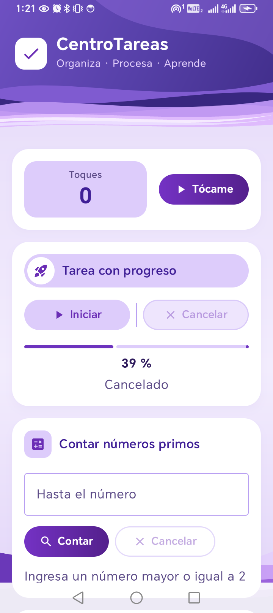
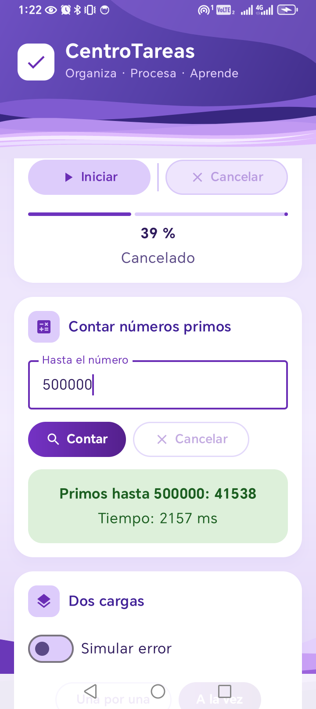
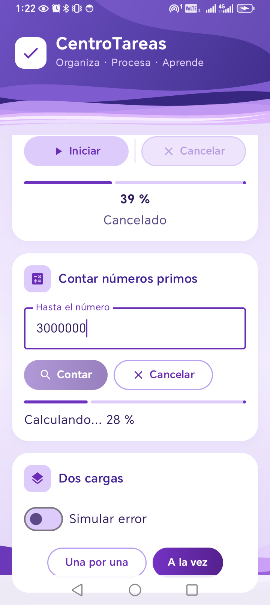
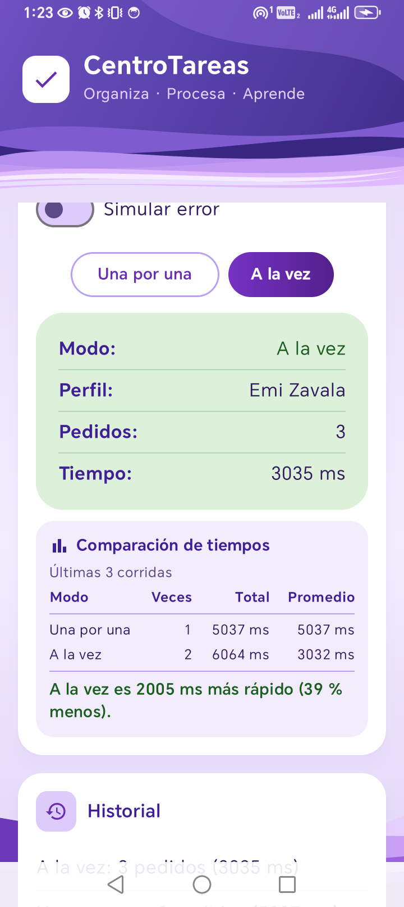
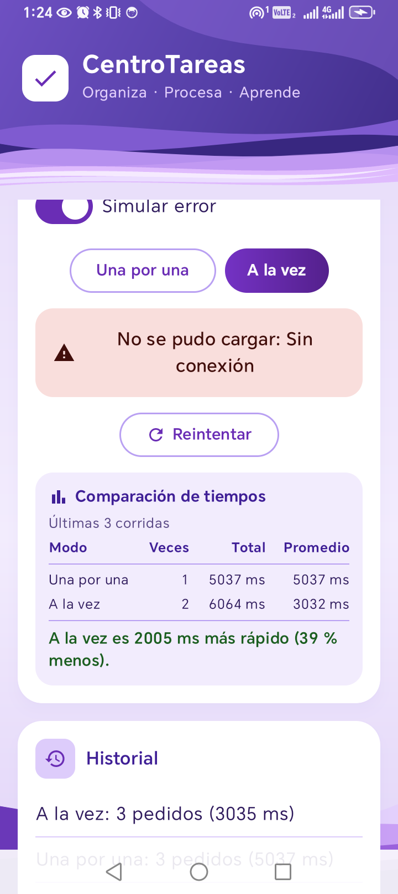
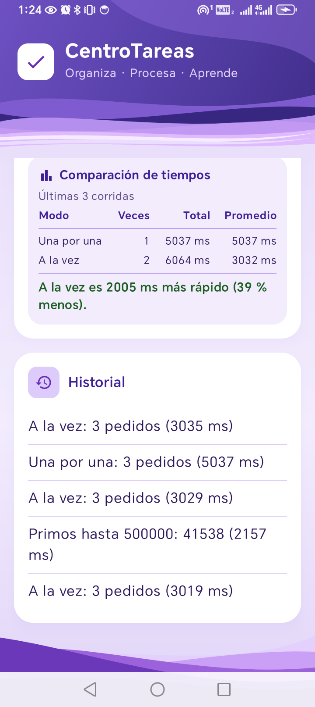

# CentroTareas

**Nombre:** Noemi De La Cruz
**Curso:** Programación en Móviles — Semana 14
**Paquete:** `com.delacruz.centrotareas`
**Rama de la Fase 2:** `con-ia`

## Descripción

CentroTareas es una aplicación Android hecha con Kotlin y Jetpack Compose que sirve para practicar
corrutinas, hilos y trabajo en segundo plano. La pantalla tiene cinco tarjetas:

1. **Toques**: un contador que responde mientras otras tareas trabajan en segundo plano; sirve para
   comprobar que la interfaz nunca se congela.
2. **Tarea con progreso**: avanza del 0 % al 100 % en segundo plano, se puede cancelar a mitad y
   demuestra que la interfaz sigue respondiendo mientras trabaja.
3. **Contar números primos**: hace un cálculo pesado con `Dispatchers.Default`, muestra el porcentaje
   de avance, la cantidad de primos y el tiempo, y se puede cancelar sin congelar la pantalla.
4. **Dos cargas**: compara cargar dos datos uno por uno (≈5 s) contra cargarlos en paralelo con
   `async` (≈3 s), incluye un interruptor para simular un error, un botón para reintentar y una
   tabla que acumula los tiempos de las últimas corridas.
5. **Historial**: guarda con DataStore los últimos 5 resultados y los muestra al abrir la app.

## Tecnologías

- Kotlin + Jetpack Compose + Material 3
- Corrutinas, `Flow`, `StateFlow`, `flowOn` y `withContext`
- `ViewModel`, `viewModelScope` y `ViewModelProvider.Factory`
- Patrón Repository
- DataStore Preferences (`androidx.datastore:datastore-preferences:1.1.3`)
- Gradle Kotlin DSL (`minSdk 24`, `targetSdk 36`, `compileSdk 37`)
- `androidx.lifecycle:lifecycle-viewmodel-compose:2.8.7`

## Árbol de paquetes

```text
CentroTareas/
└── app/src/main/java/com/delacruz/centrotareas/
    ├── MainActivity.kt
    ├── model/
    │   └── Estados.kt                  PrimosUi, CargaUi
    ├── data/
    │   ├── TareasRepository.kt         interfaz, ProgresoPrimo e historial
    │   └── TareasRepositoryLocal.kt    cargas simuladas, contarPrimos y DataStore
    ├── viewmodel/
    │   ├── TareasViewModel.kt          estados y lógica de todos los pasos
    │   └── TareasViewModelFactory.kt
    └── ui/
        ├── PantallaTareas.kt           las cinco tarjetas
        ├── Olas.kt                     ondas decorativas del encabezado y el pie
        └── theme/                      Color.kt, Theme.kt, Type.kt
```

## Arquitectura MVVM

```text
        PantallaTareas (Compose)
          │                   ▲
          │ eventos           │ StateFlow (collectAsState)
          ▼                   │
        TareasViewModel ──────┘
          │
          │ Flow / suspend / lógica de negocio
          ▼
        TareasRepository  (interfaz)
          │
          ▼
        TareasRepositoryLocal
        (delay, Dispatchers.Default, contarPrimos, DataStore)
```

La pantalla solo dibuja el estado y envía eventos al ViewModel. El ViewModel expone `StateFlow`
de solo lectura (`mensaje`, `progreso`, `corriendo`, `primos`, `progresoPrimos`, `carga`,
`simularError`, `historialTiempos`, `historial`) y llama al Repository, que es quien ejecuta las
cargas, el cálculo y la persistencia. Así la UI no conoce los detalles de los hilos ni de la fuente
de datos.

## Observación del Paso 1

Al pulsar **Tarea larga (MAL)**, la pantalla se congela durante 4 segundos: el botón **Tócame** no
suma y la interfaz no responde. **Trabajando...** no se ve porque `Thread.sleep(4000)` bloquea el
hilo principal antes de que Compose pueda redibujar; cuando el hilo se libera, el estado ya cambió a
**Terminó**. Si la espera fuera de 10 segundos, Android mostraría el diálogo **“La aplicación no
responde” (ANR)** y ofrecería cerrar la aplicación.

## Fase 2 — Mejoras con IA

En la rama `con-ia` se aplicaron tres mejoras sobre la base de la Fase 1, manteniendo MVVM +
Repository y sin `GlobalScope`, `runBlocking` ni `Thread.sleep`. Todo lo que generó la IA se revisó,
se probó en el dispositivo y se corrigió cuando hizo falta.

| Mejora | Qué hace | Capas que cambian | Commit |
| --- | --- | --- | --- |
| **Historial de resultados** | Guarda con DataStore los últimos 5 resultados (primos y cargas) y los muestra al abrir | Repository + ViewModel + View | `3a383fe` |
| **Comparación de tiempos** | Acumula los tiempos de *Una por una* y *A la vez* en una tabla con veces, total, promedio y la diferencia entre ambos promedios | ViewModel + View | `14fd50b` |
| **Primos con progreso** | Emite el porcentaje del cálculo mientras avanza desde `flow { }` con `flowOn(Dispatchers.Default)` | Repository + ViewModel + View | `3e07a8a` |

### Historial de resultados

`TareasRepository` expone `historial: Flow<List<String>>` y `guardarResultado(resultado)`. La
implementación usa DataStore Preferences: lee con `catch` para tolerar `IOException` y guarda la
lista más reciente primero, recortada a 5 elementos. El ViewModel la convierte en `StateFlow` con
`stateIn(..., SharingStarted.WhileSubscribed(5000))`.

### Comparación de tiempos

El ViewModel registra cada corrida en `historialTiempos` (máximo 10 en memoria) con un
`data class TiempoCarga(modo, milisegundos)`. La vista agrupa por modo y calcula veces, total y
promedio, y escribe la diferencia:

```text
A la vez es 2005 ms más rápido (39 % menos).
```

### Primos con progreso

`contarPrimos(hasta)` ya no devuelve un `Int`: devuelve `Flow<ProgresoPrimo>` con el porcentaje y la
cantidad acumulada. Emite aproximadamente cada 1 % del recorrido, comprueba la cancelación con
`currentCoroutineContext().ensureActive()` y ejecuta el cálculo en `Dispatchers.Default` con
`flowOn`. El ViewModel colecciona el `Flow`, publica `progresoPrimos` y relanza la
`CancellationException` para no romper la cancelación.

Resultado medido con `N = 500000`: **41538 primos en 2157 ms**, con el porcentaje avanzando durante
el cálculo. Con `N = 3000000` la barra llega al 61 % antes de cancelar.

## Capturas

### Tarea con progreso (69 %)


### Tarea cancelada (39 %)



### Números primos



### Primos con progreso



### Dos cargas: tabla de resultado y comparación



| Modo | Tiempo medido |
| --- | --- |
| Una por una | 5037 ms (2 s + 3 s) |
| A la vez | 3035 ms (el máximo de las dos) |

### Error simulado y reintento



### Historial persistente



## Pruebas de aceptación

### Fase 1

| Prueba | Resultado esperado | Estado |
| --- | --- | --- |
| Tarea larga: tocar Tócame mientras trabaja | El contador sigue sumando | ✅ |
| Logcat con filtro HILO | `main` antes y después; `DefaultDispatcher-worker` dentro | ✅ |
| Iniciar la tarea con progreso | La barra avanza de 0 a 100 % en ≈4 s | ✅ |
| Cancelar a mitad | La barra se detiene, dice Cancelado y se puede iniciar otra vez | ✅ (39 %) |
| Pulsar Iniciar dos veces seguidas | No se lanzan dos tareas | ✅ |
| Primos hasta 1000 | Resultado 168 | ✅ |
| Primos con N grande | La pantalla no se congela y Cancelar funciona | ✅ (3 000 000) |
| Una por una | ≈5 s y resultado correcto | ✅ (5037 ms) |
| A la vez | ≈3 s y resultado correcto | ✅ (3035 ms) |
| Error simulado + Reintentar | Recuadro rojo; al desactivar el interruptor y reintentar, éxito | ✅ |
| Rotar la pantalla durante la tarea | La tarea continúa y el progreso no se reinicia | ✅ (45 % → 100 %) |
| Revisar el código | Sin `GlobalScope`, `runBlocking` ni `Thread.sleep` | ✅ |

### Fase 2

| Prueba | Resultado esperado | Estado |
| --- | --- | --- |
| Comparación de tiempos | Acumula las corridas y muestra veces, total y promedio | ✅ |
| Diferencia entre modos | Indica cuántos ms y qué porcentaje es más rápido | ✅ (39 % menos) |
| Primos con progreso | El porcentaje avanza mientras calcula | ✅ (500000 → 41538) |
| Cancelar primos con progreso | Se detiene, dice Cancelado y no deja corrutinas vivas | ✅ (61 %) |
| Historial tras cerrar la app | Los últimos 5 resultados siguen al volver a abrir | ✅ |
| Historial con más de 5 resultados | Solo conserva los 5 más recientes | ✅ |
| Revisar el código | Se relanza la `CancellationException` | ✅ |

## Para pensar

1. **¿Por qué no se veía Trabajando... en el Paso 1?**
   Porque `Thread.sleep` bloquea el hilo principal. Compose no puede ejecutar el redibujado hasta
   que el hilo se libera, así que el cambio a **Trabajando...** nunca llega a pintarse y solo se ve
   el estado final, **Terminó**.

2. **¿Qué diferencia hay entre `Thread.sleep` y `delay`?**
   `Thread.sleep` bloquea el hilo que lo ejecuta (en el Paso 1, el hilo principal) y no es
   cancelable. `delay` es una función `suspend`: libera el hilo mientras espera, reanuda la corrutina
   después y responde a la cancelación.

3. **¿Por qué `Dispatchers.Default` para los primos y `Dispatchers.IO` para la red?**
   `Default` está pensado para trabajo intensivo de CPU y usa un pool del tamaño de los núcleos.
   `IO` está pensado para tareas de entrada/salida que pasan mucho tiempo esperando (red, disco) y
   permite más hilos simultáneos sin saturar la CPU.

4. **¿Qué pasaría con la corrutina si el usuario cierra la pantalla? ¿Qué papel cumple `viewModelScope`?**
   `viewModelScope` está atado al ciclo de vida del ViewModel. Cuando la pantalla se destruye de
   forma definitiva, el scope se cancela y las corrutinas se detienen, evitando fugas de memoria y
   trabajo innecesario. En una rotación el ViewModel sobrevive, por eso la tarea continúa y el
   progreso no se reinicia.

5. **¿Por qué `async` tarda 3 s y no 5 s? ¿Qué pasa si una de las dos cargas falla?**
   Porque las dos cargas corren en paralelo: el tiempo total es el máximo (3 s), no la suma
   (2 s + 3 s = 5 s). Si una falla, `await()` relanza la excepción, `coroutineScope` cancela la otra
   carga y el `try/catch` del ViewModel publica `CargaUi.Error`, mostrando el recuadro rojo con
   **Reintentar**.

6. **¿Por qué `contarPrimos` devuelve un `Flow` y no un `Int`?**
   Porque el cálculo es largo y el usuario necesita ver el avance. Un `Flow` permite emitir valores
   intermedios (`porcentaje`, `cantidad`) sin bloquear y sin esperar al resultado final; `flowOn`
   mueve toda la emisión a `Dispatchers.Default` y `ensureActive()` corta el bucle en cuanto se
   cancela.

7. **¿Qué aporta DataStore frente a guardar el historial en una variable del ViewModel?**
   El ViewModel vive mientras vive la pantalla; DataStore escribe en disco de forma asíncrona y
   transaccional, así que el historial sobrevive al cierre de la app. Además expone un `Flow` que
   avisa a la UI cuando cambia el dato, sin necesidad de refrescar manualmente.

## Cómo ejecutar

1. Abrir la carpeta `CentroTareas` en Android Studio.
2. Sincronizar Gradle y ejecutar la configuración `app` en un dispositivo o emulador Android.
3. También se puede compilar desde la terminal con `./gradlew :app:assembleDebug`.
