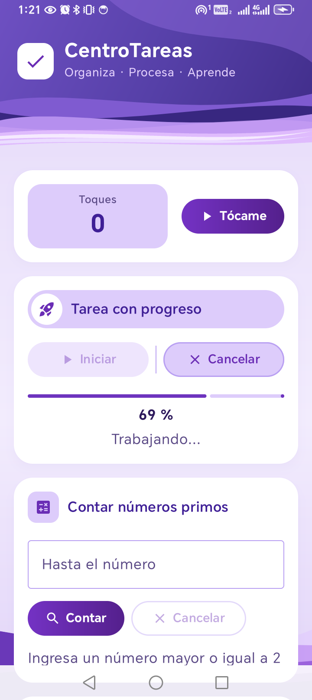

# CentroTareas

**Nombre:** Noemi De La Cruz
**Curso:** Programación en Móviles — Semana 14

App Android en Kotlin + Jetpack Compose con MVVM + Repository para practicar corrutinas: tarea con
progreso, conteo de primos, dos cargas comparadas e historial.

## Mejoras de la Fase 2

- **Historial con DataStore**: guarda los últimos 5 resultados y los muestra al abrir.
- **Comparación de tiempos**: tabla con veces, total, promedio y diferencia entre modos.
- **Primos con progreso**: porcentaje del cálculo en vivo con `Flow` y `flowOn(Dispatchers.Default)`.
- **Cambio visual**: paleta lavanda, tarjetas con sombra, botones píldora y componentes extraídos a
  `ui/componentes/` (`Tarjetas.kt`, `Botones.kt`, `TablaComparacionTiempos.kt` y `Olas.kt`).

## Árbol de paquetes

```text
app/src/main/java/com/delacruz/centrotareas/
├── MainActivity.kt
├── model/
│   └── Estados.kt
├── data/
│   ├── TareasRepository.kt
│   └── TareasRepositoryLocal.kt
├── viewmodel/
│   ├── TareasViewModel.kt
│   └── TareasViewModelFactory.kt
└── ui/
    ├── PantallaTareas.kt
    ├── componentes/
    │   ├── Tarjetas.kt
    │   ├── Botones.kt
    │   ├── TablaComparacionTiempos.kt
    │   └── Olas.kt
    └── theme/
        ├── Color.kt
        ├── Theme.kt
        └── Type.kt
```

## Capturas

## Capturas

| Tarea con progreso | Primos con progreso | Dos cargas y comparación de tiempos | Historial persistente |
| :---: | :---: | :---: | :---: |
|  |  |  |  |
   

## Prompts y ejecución

- Prompts y decisiones: [PROMPTS.md](PROMPTS.md)
- Ejecutar: abrir la carpeta `CentroTareas` en Android Studio y correr la configuración `app`, o
  compilar con `./gradlew :app:assembleDebug`.
