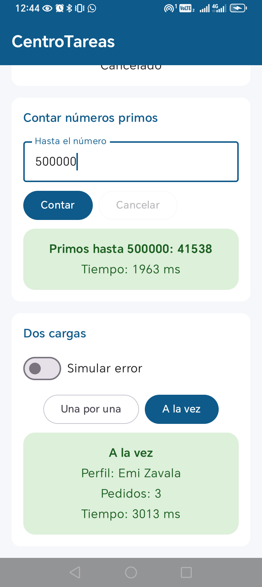
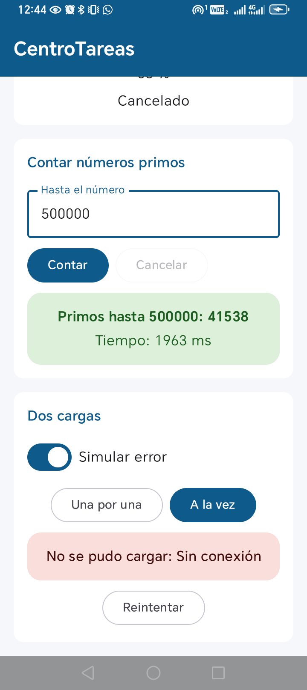

# CentroTareas

**Nombre:** Noemi De La Cruz
**Curso:** Programación en Móviles — Semana 14
**Paquete:** `com.delacruz.centrotareas`

## Descripción

CentroTareas es una aplicación Android hecha con Kotlin y Jetpack Compose que sirve para practicar
corrutinas, hilos y trabajo en segundo plano. La pantalla tiene tres tarjetas:

1. **Tarea con progreso**: avanza del 0 % al 100 % en segundo plano, se puede cancelar a mitad y
   demuestra que la interfaz sigue respondiendo mientras trabaja.
2. **Contar números primos**: hace un cálculo pesado con `Dispatchers.Default`, muestra la cantidad
   de primos y el tiempo, y se puede cancelar sin congelar la pantalla.
3. **Dos cargas**: compara cargar dos datos uno por uno (≈5 s) contra cargarlos en paralelo con
   `async` (≈3 s), e incluye un interruptor para simular un error y un botón para reintentar.

## Tecnologías

- Kotlin + Jetpack Compose + Material 3
- Corrutinas y `Flow` / `StateFlow`
- `ViewModel`, `viewModelScope` y `ViewModelProvider.Factory`
- Patrón Repository
- Gradle Kotlin DSL (`minSdk 24`, `targetSdk 36`, `compileSdk 37`)
- `androidx.lifecycle:lifecycle-viewmodel-compose:2.8.7`

## Árbol de paquetes

```text
CentroTareas/
└── app/src/main/java/com/delacruz/centrotareas/
    ├── MainActivity.kt
    ├── model/
    │   └── Estados.kt                  PrimosUi, CargaUi
    ├── data/
    │   ├── TareasRepository.kt         interfaz
    │   └── TareasRepositoryLocal.kt    cargas simuladas y contarPrimos
    ├── viewmodel/
    │   ├── TareasViewModel.kt          estados y lógica de los pasos 1 a 7
    │   └── TareasViewModelFactory.kt
    └── ui/
        ├── PantallaTareas.kt           las tres tarjetas
        └── theme/                      Color.kt, Theme.kt, Type.kt
```

## Arquitectura MVVM

```text
        PantallaTareas (Compose)
          │                   ▲
          │ eventos           │ StateFlow (collectAsState)
          ▼                   │
        TareasViewModel ──────┘
          │
          │ suspend / lógica de negocio
          ▼
        TareasRepository  (interfaz)
          │
          ▼
        TareasRepositoryLocal
        (delay, Dispatchers.Default, contarPrimos)
```

La pantalla solo dibuja el estado y envía eventos al ViewModel. El ViewModel expone `StateFlow`
de solo lectura (`mensaje`, `progreso`, `corriendo`, `primos`, `carga`, `simularError`) y llama al
Repository, que es quien ejecuta las cargas y el cálculo. Así la UI no conoce los detalles de los
hilos ni de la fuente de datos.

## Observación del Paso 1

Al pulsar **Tarea larga (MAL)**, la pantalla se congela durante 4 segundos: el botón **Tócame** no
suma y la interfaz no responde. **Trabajando...** no se ve porque `Thread.sleep(4000)` bloquea el
hilo principal antes de que Compose pueda redibujar; cuando el hilo se libera, el estado ya cambió a
**Terminó**. Si la espera fuera de 10 segundos, Android mostraría el diálogo **“La aplicación no
responde” (ANR)** y ofrecería cerrar la aplicación.

## Capturas

### Tarea con progreso (70 %)


### Tarea cancelada (38 %)


### Números primos


### Una por una contra a la vez



| Modo | Tiempo medido |
| --- | --- |
| Una por una | 5037 ms (2 s + 3 s) |
| A la vez | 3013 ms (el máximo de las dos) |

### Error simulado y reintento



## Pruebas de aceptación

| Prueba | Resultado esperado | Estado |
| --- | --- | --- |
| Tarea larga: tocar Tócame mientras trabaja | El contador sigue sumando | ✅ |
| Logcat con filtro HILO | `main` antes y después; `DefaultDispatcher-worker` dentro | ✅ |
| Iniciar la tarea con progreso | La barra avanza de 0 a 100 % en ≈4 s | ✅ |
| Cancelar a mitad | La barra se detiene, dice Cancelado y se puede iniciar otra vez | ✅ (38 %) |
| Pulsar Iniciar dos veces seguidas | No se lanzan dos tareas | ✅ |
| Primos hasta 1000 | Resultado 168 | ✅ |
| Primos con N grande | La pantalla no se congela y Cancelar funciona | ✅ (3 000 000) |
| Una por una | ≈5 s y resultado correcto | ✅ (5037 ms) |
| A la vez | ≈3 s y resultado correcto | ✅ (3013 ms) |
| Error simulado + Reintentar | Recuadro rojo; al desactivar el interruptor y reintentar, éxito | ✅ |
| Rotar la pantalla durante la tarea | La tarea continúa y el progreso no se reinicia | ✅ (45 % → 100 %) |
| Revisar el código | Sin `GlobalScope`, `runBlocking` ni `Thread.sleep` | ✅ |

## Para pensar

1. **¿Por qué no se veía Trabajando... en el Paso 1?**
   Porque `Thread.sleep` bloquea el hilo principal. Compose no puede ejecutar el redibujado hasta
   que el hilo se libera, así que el cambio a **Trabajando...** nunca llega a pintarse y solo se ve
   el estado final, **Terminó**.

2. **¿Qué diferencia hay entre `Thread.sleep` y `delay`?**
   `Thread.sleep` bloquea el hilo que lo ejecuta (en el Paso 1, el hilo principal) y no es
   cancelable. `delay` es una función `suspend`: libera el hilo mientras espera, reanuda la corrutina
   después y responde a la cancelación.

3. **¿Por qué `Dispatchers.Default` para los primos y `Dispatchers.IO` para la red?**
   `Default` está pensado para trabajo intensivo de CPU y usa un pool del tamaño de los núcleos.
   `IO` está pensado para tareas de entrada/salida que pasan mucho tiempo esperando (red, disco) y
   permite más hilos simultáneos sin saturar la CPU.

4. **¿Qué pasaría con la corrutina si el usuario cierra la pantalla? ¿Qué papel cumple `viewModelScope`?**
   `viewModelScope` está atado al ciclo de vida del ViewModel. Cuando la pantalla se destruye de
   forma definitiva, el scope se cancela y las corrutinas se detienen, evitando fugas de memoria y
   trabajo innecesario. En una rotación el ViewModel sobrevive, por eso la tarea continúa y el
   progreso no se reinicia.

5. **¿Por qué `async` tarda 3 s y no 5 s? ¿Qué pasa si una de las dos cargas falla?**
   Porque las dos cargas corren en paralelo: el tiempo total es el máximo (3 s), no la suma
   (2 s + 3 s = 5 s). Si una falla, `await()` relanza la excepción, `coroutineScope` cancela la otra
   carga y el `try/catch` del ViewModel publica `CargaUi.Error`, mostrando el recuadro rojo con
   **Reintentar**.

## Cómo ejecutar

1. Abrir la carpeta `CentroTareas` en Android Studio.
2. Sincronizar Gradle y ejecutar la configuración `app` en un dispositivo o emulador Android.
3. También se puede compilar desde la terminal con `./gradlew :app:assembleDebug`.
