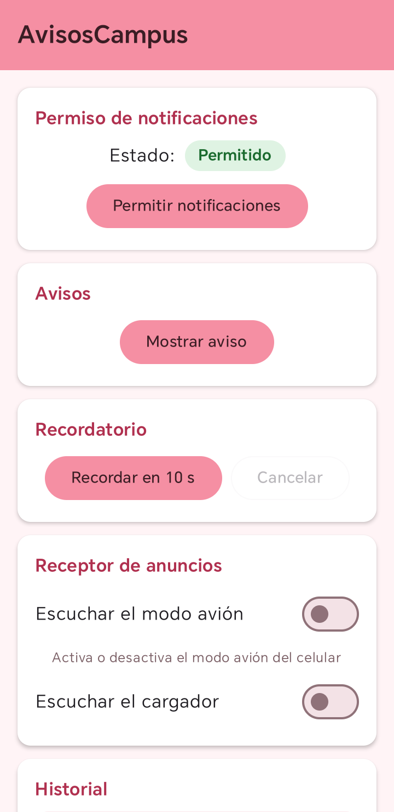
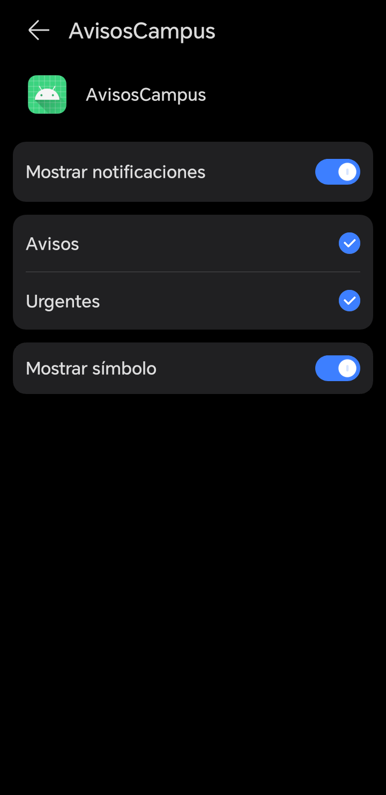
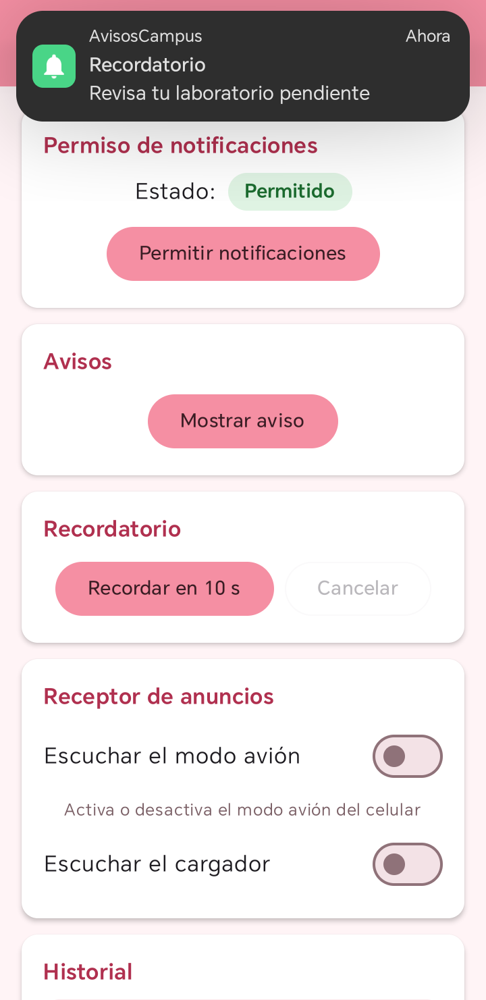
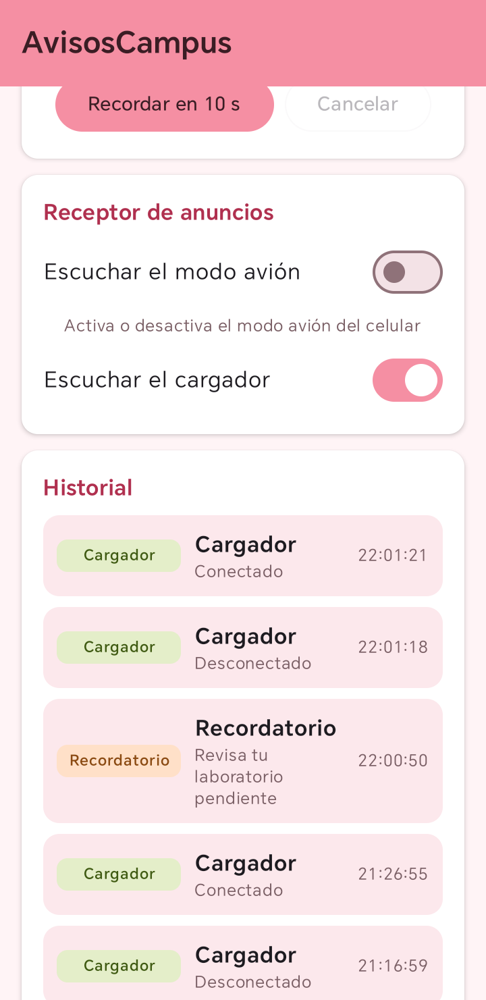
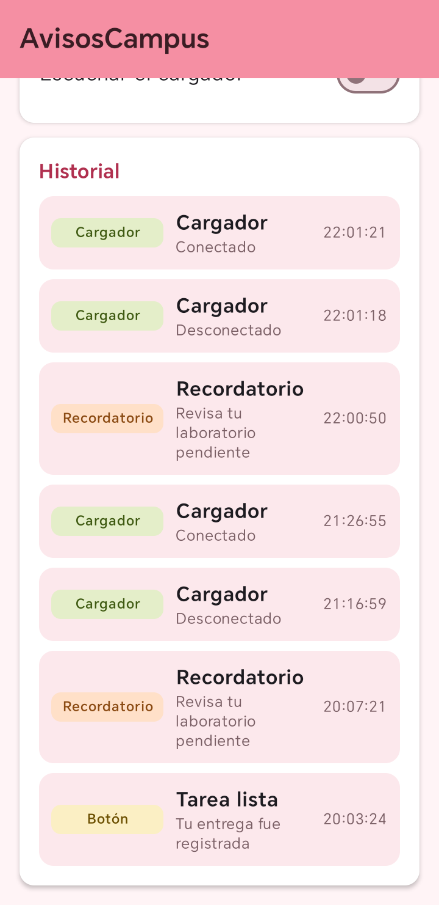

# AvisosCampus

**Nombre:** Noemi De La Cruz
**Curso:** Programación en Móviles — Semana 15 (Fase 2, rama `con-ia`)

App Android en Kotlin + Jetpack Compose + Material 3 con MVVM + Repository que muestra
notificaciones locales y escucha eventos del celular. Esta rama parte de la Fase 1 (rama `sin-ia`) y
le agrega **3 mejoras** hechas con Gemini, más un cambio visual. El detalle de la Fase 1 (arquitectura,
respuestas de *Para pensar* y pruebas de aceptación) está en el README de `sin-ia`.

## Mejoras de la Fase 2

| Mejora | Qué hace | Capas que cambian |
| --- | --- | --- |
| **Dos canales** | Canal **Urgentes** con `IMPORTANCE_HIGH` (aparece emergente) junto al canal **Avisos**. El recordatorio de 10 s usa el urgente. | `Notificador` |
| **Receptor del cargador** | Avisa cuando el cargador se conecta o se desconecta (`ACTION_POWER_CONNECTED` y `ACTION_POWER_DISCONNECTED`), con su propio switch y su propio `DisposableEffect`. | `CargadorReceiver` + `Origen.CARGADOR` + ViewModel + View |
| **Historial persistente** | Guarda el historial con DataStore (JSON) para que no se pierda al cerrar la app. Los ids de los avisos continúan desde el más alto guardado. | Repository nuevo (`AvisosRepositoryDataStore`) + `MainActivity` |
| **Cambio visual** (extra) | Paleta rosa salmón, etiquetas de origen de ancho fijo y texto oscuro sobre el color principal para mantener el contraste. | `Color.kt`, `Theme.kt`, `PantallaAvisos.kt`, `HistorialAvisos.kt` |

La arquitectura se mantiene: el ViewModel sigue sin `Context`, `NotificationManager` ni
`BroadcastReceiver`; el Repository sigue sin `Context`; y todo receptor registrado se quita con
`unregisterReceiver` en `onDispose`. El ViewModel recibe la interface `AvisosRepository`, por eso
cambiar de memoria a DataStore no lo afectó.

## Árbol de paquetes

```text
app/src/main/java/com/delacruz/avisoscampus/
├── AvisosApp.kt
├── MainActivity.kt                  (modificado: crea el DataStore y el nuevo Repository)
├── model/
│   └── Modelos.kt                   (modificado: Origen.CARGADOR)
├── data/
│   ├── AvisosRepository.kt          (interface + versión en memoria, sin cambios)
│   └── AvisosRepositoryDataStore.kt (nuevo)
├── notificacion/
│   └── Notificador.kt               (modificado: canal Urgentes)
├── receiver/
│   ├── ModoAvionReceiver.kt
│   └── CargadorReceiver.kt          (nuevo)
├── viewmodel/
│   ├── AvisosViewModel.kt           (modificado: estado y funciones del cargador)
│   └── AvisosViewModelFactory.kt
└── ui/
    ├── PantallaAvisos.kt            (modificado: switch del cargador y estilo)
    ├── HistorialAvisos.kt           (modificado: etiqueta Cargador y estilo)
    └── theme/
        ├── Color.kt                 (modificado: paleta rosa salmón)
        ├── Theme.kt                 (modificado)
        └── Type.kt
```

## Capturas

| Nuevo diseño | Canales en Ajustes | Recordatorio emergente | Receptor del cargador | Historial persistente |
| :---: | :---: | :---: | :---: | :---: |
|  |  |  |  |  |

## Prompts y ejecución

- Prompts y decisiones: [PROMPTS.md](PROMPTS.md)
- Ejecutar: abrir la carpeta `AvisosCampus` en Android Studio y correr la configuración `app`, o
  compilar con `./gradlew :app:assembleDebug`. Para ver el cuadro de permiso usa un emulador con
  Android 13 o superior (API 33+).