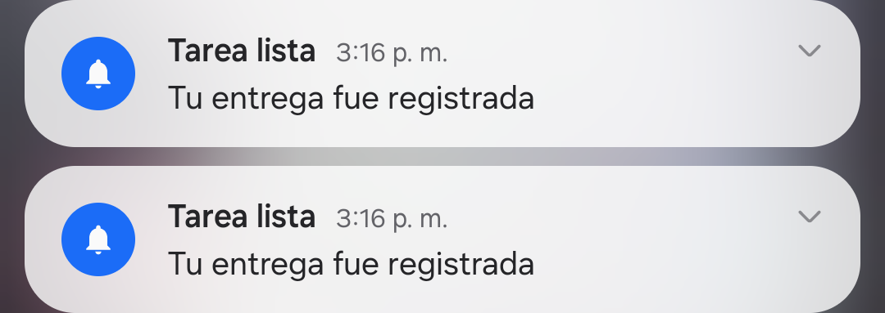
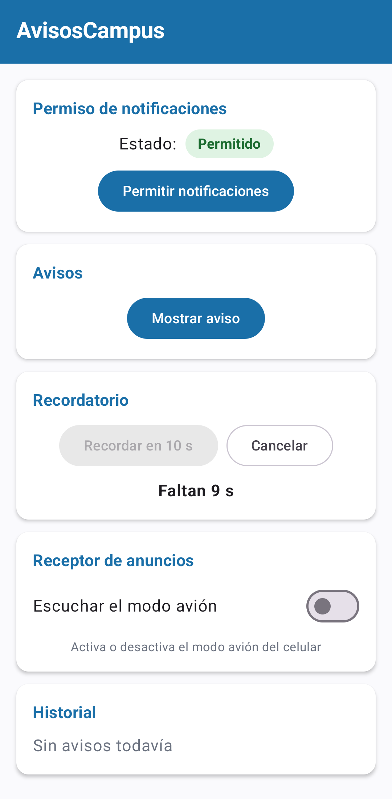
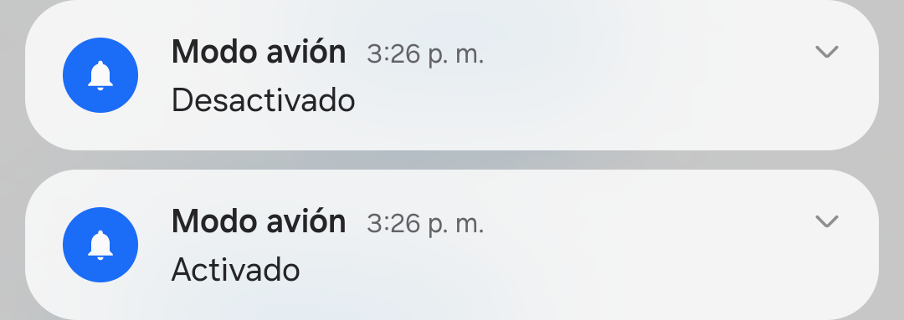
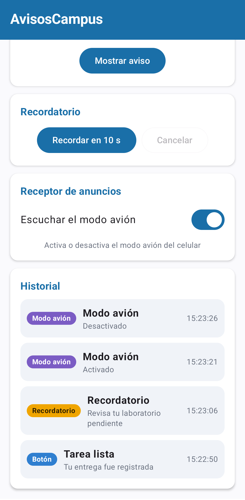
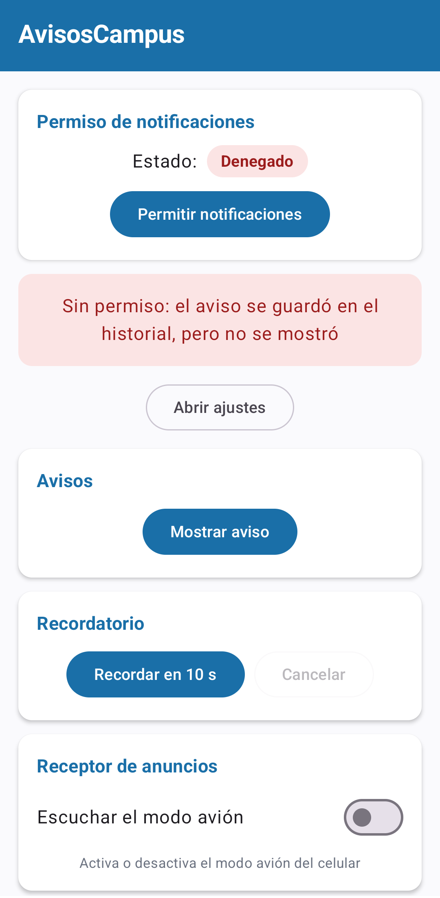

# AvisosCampus

Laboratorio N.º 15: Notificaciones en Android.
Curso: Programación en Móviles. Rama: `sin-ia`. Paquete: `com.delacruz.avisoscampus`.

## Descripción

App que muestra notificaciones locales y escucha lo que pasa en el celular:

- Crea el canal **Avisos** y pide el permiso `POST_NOTIFICATIONS` (Android 13+).
- Muestra un aviso con un botón y abre la app al tocar la notificación.
- Programa un recordatorio de 10 segundos con cuenta regresiva y opción de cancelar.
- Avisa cuando se activa o desactiva el modo avión, con un `BroadcastReceiver`.
- Guarda los avisos en un historial en memoria, con lo más reciente arriba.
- Si el permiso está denegado, muestra un mensaje y un botón para abrir los ajustes.

Tecnologías: Kotlin, Jetpack Compose, Material 3, corrutinas y MVVM + Repository. Solo usa datos ficticios.

## Estructura de paquetes

```
com.delacruz.avisoscampus/
├── AvisosApp.kt                  Application: crea el canal
├── MainActivity.kt
├── model/
│   └── Modelos.kt                Aviso, Origen, PermisoUi
├── data/
│   └── AvisosRepository.kt       interface + AvisosRepositoryMemoria
├── notificacion/
│   └── Notificador.kt            canal, permiso y mostrar
├── receiver/
│   └── ModoAvionReceiver.kt
├── viewmodel/
│   ├── AvisosViewModel.kt
│   └── AvisosViewModelFactory.kt
└── ui/
    ├── PantallaAvisos.kt
    ├── HistorialAvisos.kt
    └── theme/
```

## Arquitectura MVVM + Repository

```
View (PantallaAvisos, HistorialAvisos)
    |  eventos: botones, switch              ^  collectAsState()
    v                                        |
ViewModel (AvisosViewModel)  --- StateFlow (avisos, permiso, faltan...) ---
    |  registra el aviso          |  emite: eventos (SharedFlow<Aviso>)
    v                             v
AvisosRepository (interface)    La View recibe el evento y llama a
AvisosRepositoryMemoria         Notificador.mostrar(context, aviso)
```

El ViewModel no usa `Context`, `NotificationManager` ni `BroadcastReceiver`.

## Capturas

| Notificación en el panel | Recordatorio |
|---|---|
|  |  |

| Modo avión | Historial |
|---|---|
|  |  |

| Permiso denegado |
|---|
|  |

## Para pensar

**1. ¿Por qué una notificación necesita un canal y un permiso? ¿Qué pasa si falta cada uno?**
El canal (Android 8+) agrupa las notificaciones y deja que el usuario controle su importancia, sonido o desactivarlas. El permiso `POST_NOTIFICATIONS` (Android 13+) hace que el usuario decida si la app puede notificarle. Sin canal, desde Android 8 la notificación no se muestra y el sistema solo registra el error. Sin permiso, desde Android 13 tampoco se muestra; en esta app `mostrar` devuelve `false`, el aviso queda en el historial y aparece un mensaje.

**2. ¿Por qué el ViewModel emite un evento y no muestra la notificación él mismo?**
Porque para notificar se necesita `Context` y el ViewModel no debe tenerlo: vive más que la pantalla y guardar un `Context` puede filtrar memoria. El ViewModel decide qué avisar, lo registra y emite el evento; la pantalla, que sí tiene `Context`, llama al `Notificador`. Así el ViewModel queda separado del sistema y es más fácil de probar.

**3. ¿Qué pasa si usas el mismo id en dos notificaciones?**
La segunda reemplaza a la primera y solo se ve una. Por eso se usa `aviso.id`, que es distinto en cada aviso.

**4. ¿Por qué `onReceive` debe ser corto y por qué hay que quitar el receptor al salir?**
`onReceive` se ejecuta en el hilo principal: si tarda, la app se congela y Android puede mostrar que no responde (ANR). El receptor se quita en `onDispose` porque, si queda registrado, sigue referenciando a la pantalla, filtra memoria y puede producir avisos repetidos.

**5. ¿En qué casos usarías una notificación local y en cuáles una push de Firebase?**
Local: cuando la propia app ya sabe qué avisar y cuándo, como un recordatorio, el fin de una tarea o un cambio en el celular; no necesita internet. Push de Firebase: cuando la información nace en un servidor o en otro usuario, como una nota publicada, un mensaje o un cambio de horario, y debe llegar aunque la app no esté abierta.

## Pruebas de aceptación

Hechas en un celular Samsung SM-A135M con Android 14, manejado por `adb`.

| Prueba | Resultado observado | OK |
|---|---|---|
| Canal en el sistema | El canal `avisos` (Avisos) está registrado; se comprobó con `adb` | ✅ |
| Permitir notificaciones | Aparece el cuadro de Android y la etiqueta cambia | ✅ |
| Mostrar aviso | Aparece la notificación Tarea lista | ✅ |
| Mostrar aviso dos veces | Aparecen dos notificaciones distintas | ✅ |
| Tocar la notificación (app en segundo plano y cerrada) | Se abre la app y la notificación desaparece | ✅ |
| Recordar en 10 s | Cuenta regresiva y aviso al terminar | ✅ |
| Recordar y minimizar | El aviso llega igual | ✅ |
| Recordar y cancelar | No llega ningún aviso | ✅ |
| Switch activado y cambiar el modo avión | Aviso Activado y luego Desactivado | ✅ |
| Switch desactivado y cambiar el modo avión | No hay aviso | ✅ |
| Permiso denegado y Mostrar aviso | Mensaje de error, aviso en el historial y la app no se cierra | ✅ |
| Abrir ajustes | Abre las notificaciones de la app | ✅ |
| Volver a tener el permiso y pulsar Permitir notificaciones | El mensaje desaparece | ✅ |
| Rotar durante el recordatorio | El aviso llega al terminar la cuenta | ✅ |
| Rotar con el switch activado | Sigue escuchando | ✅ |
| Rotar con avisos en el historial | Al volver a vertical el historial se conserva | ✅ |
| Revisar el código | `viewmodel/` no usa `Context` y el receptor se quita en `onDispose` | ✅ |

**Observación:** si la app sigue abierta en segundo plano, al tocar una notificación se abre una segunda `MainActivity`, que muestra el historial vacío.

## Cómo ejecutar

1. Abre `Semana15/AvisosCampus` en Android Studio y sincroniza Gradle.
2. Ejecuta en un celular o emulador con Android 13 (API 33) o superior.
3. Toca **Permitir notificaciones** y acepta el permiso.
4. Para el modo avión, activa el switch y cambia el modo avión desde los accesos rápidos.
